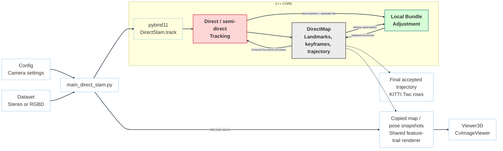
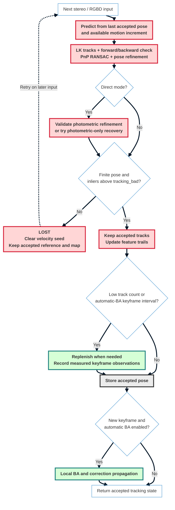
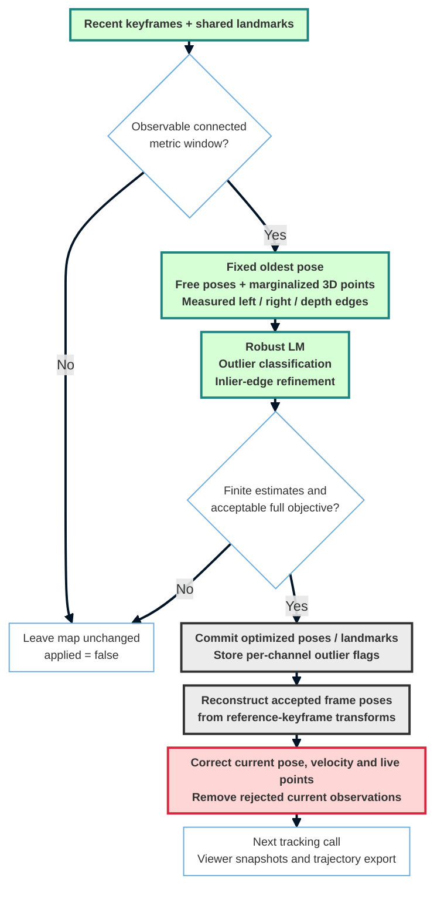

# Direct and Semi-Direct SLAM

<!-- TOC -->

- [Direct and Semi-Direct SLAM](#direct-and-semi-direct-slam)
  - [Quick Start](#quick-start)
  - [Architecture](#architecture)
  - [Tracking and Recovery](#tracking-and-recovery)
  - [Keyframes and Local Bundle Adjustment](#keyframes-and-local-bundle-adjustment)
  - [Coordinates and Measurements](#coordinates-and-measurements)
  - [Parameters](#parameters)
  - [Visualization and Trajectory Export](#visualization-and-trajectory-export)
  - [Comparison with the Main SLAM Pipeline](#comparison-with-the-main-slam-pipeline)
  - [Source Code and Validation](#source-code-and-validation)

<!-- /TOC -->

[`main_direct_slam.py`](../main_direct_slam.py) runs the C++ direct/semi-direct frontend and its local bundle-adjustment (BA) backend. It shares pySLAM's configuration, datasets, camera factory and viewers with `main_slam.py`. Its frontend was inspired by `slamplay/full_slam/vslam` and `slamplay/frontend/opticflow_direct_method`; its backend follows vslam's joint pose/landmark optimization.

The two tracking modes are:

- **`semi_direct`**: GFTT corners, pyramidal Lucas-Kanade (LK), PnP RANSAC and robust reprojection-pose refinement.
- **`direct`**: the same geometric seed, followed by sparse photometric refinement when it agrees with the geometric tracks. If the geometric seed fails, photometric-only tracking can recover with sufficient reference-landmark support.

Both modes require **stereo or RGBD input and an undistorted pinhole left camera**. They estimate metric motion from sensor depth, without using ground truth for scale. They do not provide loop closure, place recognition, global BA or dense/semantic mapping.

---

## Quick Start

Activate the pySLAM environment and build the C++ core from the repository root:

```bash
./build_cpp_core.sh
python main_direct_slam.py -c config.yaml
```

In `config.yaml`, select a stereo or RGBD dataset and the corresponding camera settings. The intrinsics, image dimensions, stereo baseline or RGBD depth factor must match the actual images. The settings files [`KITTI00-02.yaml`](../settings/KITTI00-02.yaml) and [`TUM3.yaml`](../settings/TUM3.yaml) contain commented `DIRECT_SLAM.*` examples. The runner requires `Parameters.USE_CPP_CORE` to be enabled; the selected camera calibration must satisfy the frontend's undistorted-pinhole restriction.

```bash
# Fast headless smoke test using the mode in the camera settings.
python main_direct_slam.py -c config.yaml --headless --max-frames 100

# Override the mode without editing the YAML file.
python main_direct_slam.py -c config.yaml --headless --mode direct --max-frames 1000

# Compare with automatic local BA disabled.
python main_direct_slam.py -c config.yaml --headless --no-local-ba --max-frames 1000

# Save the final corrected trajectory.
python main_direct_slam.py -c config.yaml --headless --trajectory-file /tmp/direct-kitti.txt
```

| Option                                  | Meaning                                                                                                       |
| --------------------------------------- | ------------------------------------------------------------------------------------------------------------- |
| `-c`, `--config_path`                   | Main configuration file; omitted means the normal default configuration.                                      |
| `--headless`                            | Disable both viewers and dataset-rate playback sleeps.                                                        |
| `--max-frames N`                        | Stop after N input frames; 0 means all frames.                                                                |
| `--mode semi_direct` or `--mode direct` | Override `DIRECT_SLAM.mode`, including when settings use a nested block.                                      |
| `--no-local-ba`                         | Disable automatic BA and periodic BA-driven keyframes; manual local BA remains available in interactive mode. |
| `--trajectory-file PATH`                | Export accepted poses after all local corrections, in KITTI format.                                           |

---

## Architecture

The diagrams use the tracking, local-mapping, map and component colors from the existing [SLAM workflow diagrams](./images/slam_workflow.md).



Tracking and local BA run **synchronously on the caller's thread**. The Python binding releases the GIL during native tracking/BA after copying the input arrays. Viewer processes consume copied snapshots after the call returns. There is no background mapping worker mutating `DirectMap` concurrently.

The map keeps an archive of persistent landmark IDs, keyframes and accepted frame poses. Only the optimization graph is bounded by the local window; the archive itself is not limited to seven keyframes.

---

## Tracking and Recovery

The first frame with enough valid depth-backed corners establishes the world origin and the first keyframe. Until initialization succeeds, a later input frame can retry initialization. After that, the following flow uses the **last accepted image**, which can be older than the immediately preceding input frame:



Tracking status uses **strict** inlier thresholds:

| Status          | Meaning                                                                                                    |
| --------------- | ---------------------------------------------------------------------------------------------------------- |
| `INIT`          | Fresh or reset system, before a track attempt initializes it.                                              |
| `TRACKING_GOOD` | Accepted pose with inliers strictly greater than `num_features_tracking`.                                  |
| `TRACKING_BAD`  | Accepted pose with inliers above `num_features_tracking_bad`, up to and including `num_features_tracking`. |
| `LOST`          | Initialization or tracking did not obtain sufficient support.                                              |

A failed tracking frame does not integrate the predicted motion, create keyframes, or add a trajectory row. Recovery retries against the retained reference and does not change the world origin. This is local tracking recovery, not place-recognition relocalization. Persistent loss needs an explicit reset. Feature trails break across failed or skipped input frames.

Some validation limits are currently fixed in the implementation: LK forward/backward error is at most **1.5 px**, rectified stereo vertical mismatch is at most **2 px**, and usable sensor depth is in **(0.5, 80) m**. The configured `stereo_max_error` applies to calibrated native-rig triangulation.

---

## Keyframes and Local Bundle Adjustment

A low live-track count triggers corner replenishment and keyframe recording. With automatic local BA enabled, `max_keyframe_interval` also limits the gap between keyframe input IDs, even if tracking remains strong. Existing landmarks keep their IDs; new corners create new landmarks. Keyframes record left pixels and independently measured right pixels or RGBD depths. A predicted map depth is not used as a replacement sensor measurement in BA.

The backend follows vslam's joint pose/landmark formulation, with these implementation choices:

- The active set is the latest `num_active_keyframes` keyframes, in chronological order. vslam removes keyframes by distance instead.
- The oldest active pose is fixed. Metric observations of shared landmarks constrain scale; disconnected, insufficiently shared or scale-unconstrained windows are skipped.
- Residuals are left-camera reprojection, right-camera reprojection for stereo, and measured z depth for RGBD. Native rigs use the calibrated right-camera projection and full left-to-right transform.
- Initial robust Levenberg-Marquardt runs up to `ba_iterations` iterations. Outlier edges are excluded before a second refinement of up to `max(1, ba_iterations / 2)` iterations.
- The final full robust objective is checked, including excluded edges. Non-finite or rejected solutions leave map estimates and observation flags unchanged.



`bundle_adjustment()` runs one manual local solve even when automatic `local_ba` is false. `last_ba()` reports whether the latest attempt was applied, graph sizes, rejected residual-edge count, and summed robust chi-square costs. Its `observations` field counts edges, not unique keyframe/landmark pairs. A left, right and depth rejection have separate flags.

For RGBD, the depth standard deviation is:

```text
sigma_z = ba_depth_sigma * max(1, z*z) meters
information_z = 1 / sigma_z^2
```

A larger `ba_depth_sigma` gives depth residuals less weight. The same configured value is not a universal sensor noise calibration.

---

## Coordinates and Measurements

| Quantity                                  | Convention                                                                                        |
| ----------------------------------------- | ------------------------------------------------------------------------------------------------- |
| `CameraPose`, `pose()`, `trajectory()`    | `Tcw`: world coordinates to the left camera.                                                      |
| Viewer poses, `keyframes()`, KITTI export | `Twc = inverse(Tcw)`: camera coordinates to the world.                                            |
| Persistent landmark                       | World position `Pw`; current camera position is `Pc = Tcw * Pw`.                                  |
| Accepted non-keyframe pose                | `T_frame_world = T_frame_reference * T_reference_world`; reconstruct after reference-keyframe BA. |
| Photometric SE3 update                    | Left increment with `[tx, ty, tz, wx, wy, wz]`.                                                   |
| Reprojection/BA SE3 update                | Left increment with `[wx, wy, wz, tx, ty, tz]`, matching g2o.                                     |
| RGBD depth                                | Raw sample multiplied by `Camera.depth_factor` (normally the reciprocal of `DepthMapFactor`).     |
| Rectified stereo depth                    | `z = Camera.bf / (u_left - u_right)`, for positive disparity and valid epipolar/depth checks.     |

Depth remains metric when photometric image coordinates and intrinsics are scaled through the pyramid. Pose corrections do not change the observed image pixels stored in keyframes or feature trails.

---

## Parameters

Parameters live in the camera settings file under `DIRECT_SLAM.*`; [`direct_params.h`](../cpp/core/slam_direct/direct_params.h) documents every default. The parser also accepts a nested `DIRECT_SLAM` dictionary or an already-extracted block. A nested block takes precedence over flat keys. Missing fields retain the C++ defaults. CLI mode/BA overrides update both settings forms.

All defaults below come from `DirectSlamParams`; they are not a replacement for dataset-specific calibration or tuning.

| Parameter (`DIRECT_SLAM.` prefix)  | Default       | Meaning                                                                                          |
| ---------------------------------- | ------------- | ------------------------------------------------------------------------------------------------ |
| `mode`                             | `semi_direct` | Tracking mode: semi_direct uses LK + geometry; direct adds photometric refinement/fallback.      |
| `num_features`                     | `200`         | Maximum GFTT corners per detection; also the target live-track count when replenishing.          |
| `gftt_quality`                     | `0.01`        | Minimum corner response relative to the strongest corner (0 < value <= 1).                       |
| `gftt_min_distance`                | `5.0`         | Minimum distance between detected corners, in full-resolution pixels.                            |
| `gftt_block_size`                  | `5`           | GFTT corner-response neighborhood side length, in pixels.                                        |
| `border`                           | `20`          | Image-border exclusion margin for detection and LK validity, in pixels.                          |
| `lk_patch_size`                    | `11`          | LK search-window side length, in pixels at each pyramid level (left/right and temporal).         |
| `lk_max_level`                     | `3`           | Highest zero-based LK pyramid level; 3 means levels 0 through 3.                                 |
| `half_patch_size`                  | `1`           | Photometric patch half-width; 1 samples a 3x3 patch at each pyramid level.                       |
| `num_iterations`                   | `10`          | Maximum photometric Gauss-Newton iterations per pyramid level.                                   |
| `eps_convergence`                  | `1e-3`        | Pose/photometric Gauss-Newton stop threshold for the SE3 update norm (mixed m/rad).              |
| `num_pyramid_levels`               | `4`           | Number of photometric pyramid levels, including the full-resolution image.                       |
| `pyramid_scale`                    | `0.5`         | Photometric image/intrinsic scale between adjacent levels (0 < value < 1).                       |
| `intensity_inlier_threshold`       | `25.0`        | Gray-level threshold: per-sample Huber cutoff and per-patch mean absolute inlier error.          |
| `num_features_tracking`            | `50`          | TRACKING_GOOD requires strictly more geometric/accepted inliers than this count.                 |
| `num_features_tracking_bad`        | `20`          | Accepted tracking requires strictly more inliers than this count; otherwise LOST.                |
| `num_features_needed_for_keyframe` | `80`          | Replenish tracks and insert a keyframe when the live-track count falls below this value.         |
| `pose_iterations`                  | `4`           | Outer reprojection-pose rounds; each round reclassifies geometric outliers.                      |
| `pose_inner_iterations`            | `10`          | Maximum Gauss-Newton steps per reprojection-pose round.                                          |
| `chi2_threshold`                   | `5.991`       | Squared pixel-error gate for pose/BA reprojection; its square root is the Huber cutoff.          |
| `stereo_max_error`                 | `2.5`         | Native-rig triangulation reprojection tolerance (px); rectified stereo uses a fixed 2 px y gate. |
| `local_ba`                         | `true`        | Run synchronous local BA on keyframes; manual bundle_adjustment() remains available.             |
| `num_active_keyframes`             | `7`           | Maximum recent keyframes in the BA window (>= 2); the oldest window pose is fixed.               |
| `ba_iterations`                    | `10`          | Initial robust LM iteration cap; refinement uses max(1, ba_iterations / 2) iterations.           |
| `max_keyframe_interval`            | `10`          | Force a keyframe after this input-frame ID gap when automatic BA is enabled.                     |
| `ba_depth_sigma`                   | `0.02`        | RGBD depth sigma (m) = value * max(1, z*z); larger values weaken depth constraints.              |

Start with `semi_direct` and the existing dataset settings. Raise `num_features` or lower the GFTT quality threshold if initialization has too few corners; this increases detection/tracking work. Larger LK windows and more LK levels can help larger image motion, at additional cost. Larger BA windows increase optimizer cost and retain more inter-keyframe constraints. Raising `chi2_threshold` or `intensity_inlier_threshold` admits more residual error, so inspect the resulting tracking and map rather than tuning only for a higher inlier count.

---

## Visualization and Trajectory Export

Without `--headless`, the runner uses the same `Viewer3D` and `CvImageViewer` as `main_slam.py`. It shows keyframes, the current camera, the full valid landmark archive as **black points**, the estimated trajectory as a **blue line**, and ground truth when configured. The line uses all accepted camera centers, including non-keyframes, and is rebuilt from corrected poses after local BA; reset clears the old path. Snapshot downsampling limits the displayed point count without pruning the map. Interactive playback is paced at the dataset frame rate.

Tracked features use the shared [`feature_trails.h`](../cpp/core/slam/utils/feature_trails.h) helper also called by sparse-SLAM `Frame`: stable ID colors, filled 4-pixel markers, antialiased trails, and the optional radius/track-age palette. GFTT corners have octave 0. Lost frames do not draw stale reference pixels on the failed input image.

Pause, step, reset, local BA and quit are supported. The shared viewer's save control is not wired to this frontend. The native APIs return owned snapshots for Python consumers:

| API                     | Output                                                                                                                         |
| ----------------------- | ------------------------------------------------------------------------------------------------------------------------------ |
| `tracked_features()`    | `(ids, pixels Nx2, world_points Nx3)` for retained live tracks. While lost, these still belong to the last accepted reference. |
| `map_points()`          | Nx3 valid landmark positions, including points no longer tracked live.                                                         |
| `keyframes()`           | `(Twc_poses, timestamps)` for the keyframe archive.                                                                            |
| `trajectory()`          | Accepted `Tcw` matrices, corrected by local BA.                                                                                |
| `draw_feature_trails()` | A rendered copy of the input image.                                                                                            |

`--trajectory-file` writes the **final corrected accepted trajectory** as 12-column, row-major KITTI `Twc` rows. It is saved after tracking finishes, so later BA corrections are included. Failed inputs have no row; the file contains no frame IDs or timestamps. Frame-index evaluation therefore requires a run without losses. Reset clears the map and starts a new trajectory/world frame, so export contains the current segment only. This is a trajectory export, not a map file for `main_map_viewer.py`.

---

## Comparison with the Main SLAM Pipeline

| Capability                         | `main_direct_slam.py`                             | `main_slam.py`                                                       |
| ---------------------------------- | ------------------------------------------------- | -------------------------------------------------------------------- |
| Frontend                           | GFTT/LK and optional sparse photometric alignment | Configurable feature tracking/matching and local-map tracking        |
| Input supported by this runner     | Stereo or RGBD, undistorted pinhole left camera   | Broader sensor and camera support; see [camera models](./cameras.md) |
| Mapping                            | Persistent landmarks and synchronous local BA     | Full local mapper with additional triangulation, fusion and culling  |
| Loop closure / global optimization | Not provided                                      | Available in the full pipeline                                       |
| Dense / semantic mapping           | Not provided                                      | Optional modules                                                     |
| Recovery after tracking loss       | Retry the last accepted reference                 | Full-pipeline tracking/relocalization mechanisms                     |
| Visualization                      | Shared viewers and feature drawing                | Shared viewers and feature drawing                                   |

Local BA improves local consistency but does not remove accumulated global drift. The current backend uses a chronological window and a synchronous call rather than reproducing vslam's worker-thread scheduling and distance-based keyframe eviction.

---

## Source Code and Validation

See the [C++ direct-SLAM README](../cpp/core/slam_direct/README.md) for the source layout, regression-test commands and recorded KITTI results. The main implementation entry points are:

- [`direct_frontend.h/.cpp`](../cpp/core/slam_direct/direct_frontend.cpp): initialization, tracking, keyframe recording, failure/recovery and correction propagation.
- [`direct_aligner.h/.cpp`](../cpp/core/slam_direct/direct_aligner.cpp): sparse photometric normal equations and coarse-to-fine alignment.
- [`semi_direct_tracker.h/.cpp`](../cpp/core/slam_direct/semi_direct_tracker.cpp): GFTT, LK consistency and geometric pose estimation.
- [`direct_backend.h/.cpp`](../cpp/core/slam_direct/direct_backend.cpp): bounded joint BA, gauge checks and observation rejection.
- [`direct_map.h`](../cpp/core/slam_direct/direct_map.h): persistent observations, landmarks and reference-relative trajectory storage.
- [`direct_slam_module.h`](../cpp/core/slam_direct/py_module/direct_slam_module.h): NumPy input ownership, GIL handling and snapshot bindings.

The existing tests cover synthetic photometric and geometric motion, stereo/RGBD scale, native-rig BA, outlier rejection, fixed gauges, bounded windows, unobservable graph rejection, failure/recovery, corrected trajectories, reset, and shared feature rendering. Recorded KITTI metrics are local validation results, not a claim of equivalence to the official KITTI segment-drift score or to vslam on every dataset.
