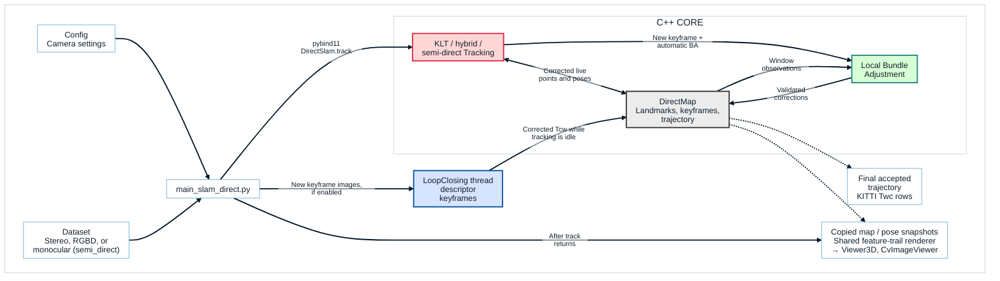
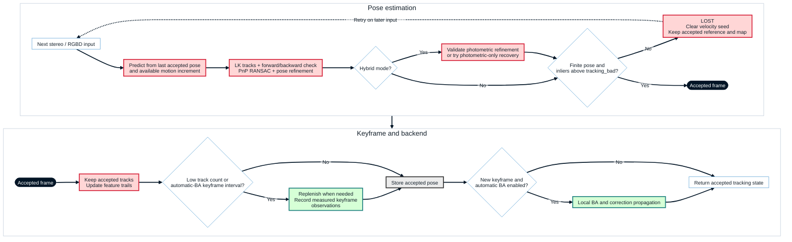
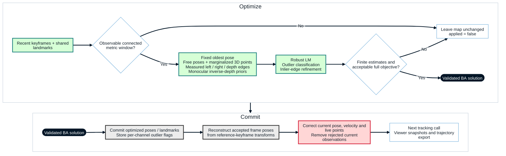

# Direct SLAM (KLT, Hybrid, and Semi-Direct Tracking)

<!-- TOC -->

- [Direct SLAM (KLT, Hybrid, and Semi-Direct Tracking)](#direct-slam-klt-hybrid-and-semi-direct-tracking)
  - [Quick Start](#quick-start)
  - [Architecture](#architecture)
  - [Tracking and Recovery](#tracking-and-recovery)
  - [Keyframes and Local Bundle Adjustment](#keyframes-and-local-bundle-adjustment)
  - [Coordinates and Measurements](#coordinates-and-measurements)
  - [Parameters](#parameters)
  - [Visualization and Trajectory Export](#visualization-and-trajectory-export)
  - [Comparison with the Main SLAM Pipeline](#comparison-with-the-main-slam-pipeline)
  - [Source Code and Validation](#source-code-and-validation)

<!-- /TOC -->

[`main_slam_direct.py`](../main_slam_direct.py) runs the C++ direct-SLAM frontend and its local bundle-adjustment (BA) backend. It shares pySLAM's configuration, datasets, camera factory and viewers with `main_slam.py`. Its frontend was inspired by `slamplay/full_slam/vslam` and `slamplay/frontend/opticflow_direct_method`; its backend follows vslam's joint pose/landmark optimization.

The tracking modes are:

- **`klt`**: grid FAST (the default) or GFTT corners, pyramidal Lucas-Kanade (LK) on the raw image, PnP RANSAC and robust reprojection-pose refinement. Kannala–Brandt, rational pinhole, and double-sphere cameras are tracked in the distorted pixels. The pose seed lifts each pixel once and runs one OpenCV RANSAC on the normalized bearings.
- **`hybrid`**: the same geometric seed, followed by sparse photometric refinement when it agrees with the geometric tracks. If the geometric seed fails, photometric-only tracking can recover with sufficient reference-landmark support. The warp projects the feature center once and slides a 2D window. It uses the camera model, so a raw-pixel camera is aligned in the distorted image.
- **`semi_direct`**: photometric alignment of a fronto-parallel patch against the reference keyframe, then an independent 2D alignment of each projected patch, then the same reprojection pose. Immature corners are inverse-depth seeds. This is the only mode that accepts a monocular camera.

`direct` is still accepted as a deprecated alias of `hybrid`. `semidirect` is accepted as `semi_direct`.

**Why "direct".** The subsystem name (`main_slam_direct.py`, `slam_direct/`, `DirectSlam`, `DIRECT_SLAM.*`) refers to how image data is used: tracking and local-mapping correspondences come from intensity on raw pixels, never from descriptor matching. Only the optional loop-closing thread extracts descriptors, on separate keyframes. Under the usual taxonomy, which looks at the error that pose and structure are optimized on, the three modes are different. `klt` is indirect: Lucas–Kanade supplies 2D tracks and the pose minimizes reprojection error, as in KLT-based front ends such as VINS-Mono. `hybrid` runs that geometric solve first and then refines it photometrically. `semi_direct` is the SVO-style mode: it minimizes intensity on a planar 3D patch before the reprojection solve, and it estimates unknown depth with a Bayesian inverse-depth filter. Local bundle adjustment stays geometric. There is no photometric bundle adjustment.

`klt` and `hybrid` require **stereo or RGBD input** and estimate metric motion from sensor depth. `semi_direct` uses the same measured landmarks when a depth or a right image is available, and it creates seeds for corners that have no measurement. A monocular `semi_direct` map takes its scale from the inverse-depth prior (`seed_min_depth`, `seed_max_depth`), not from a metric sensor. Monocular input also runs loop closing, with a Sim(3) correction. Monocular keyframes have no depth for descriptor keypoints, so a keypoint within 3 px of a direct landmark observation takes that landmark's 3D position; one descriptor point per landmark is shared by every keyframe that sees it. Most monocular landmarks are depth seeds promoted several frames after their keyframe, and appended to it then (on KITTI a keyframe ends up with about 2.5 times the observations it had when inserted). A monocular keyframe is therefore handed to loop closing three keyframes after insertion, with the observations it has by then, and its observations are read again ten keyframes after insertion to attach the landmarks promoted since. Each new keyframe also triangulates unmatched descriptor matches with its three previous keyframes, at the direct poses, and then fuses points with its ten previous keyframes in both directions (projection and descriptor distance, as in ORB-SLAM local mapping; the temporal covisibility links are kept). Sim(3) verification needs a 3D point on both sides of a match, and at least 20 inliers, so these steps decide whether a detected loop can be verified. After a loop correction or global BA, each keyframe's scale is recovered as the median ratio of its landmark-associated points' camera distances before and after (keyframes without enough of those points take the nearest estimate). Triangulated matches are not used for that scale. `apply_keyframe_poses(poses, scales)` then moves each landmark through its anchor keyframe as a similarity, and rescales inverse-depth priors, frame offsets and depth seeds. Stereo and RGBD loop closing is unchanged. `--no-loop-closing` disables it in every case. The runner does not provide dense or semantic mapping. Monocular ground truth is Sim(3)-aligned in the viewer.

---

## Quick Start

Activate the pySLAM environment and build the C++ core from the repository root:

```bash
./build_cpp_core.sh
python main_slam_direct.py -c config.yaml
```

In `config.yaml`, select a stereo or RGBD dataset and the corresponding camera settings. A monocular dataset is accepted only when the resolved mode is `semi_direct`, including when `DIRECT_SLAM.monocular.mode` selects it and the stereo mode stays `hybrid`. The intrinsics, image dimensions, stereo baseline or RGBD depth factor must match the actual images. The settings files [`KITTI00-02.yaml`](../settings/KITTI00-02.yaml), [`TUM3.yaml`](../settings/TUM3.yaml), and [`TUM_VI.yaml`](../settings/TUM_VI.yaml) contain `DIRECT_SLAM.*` examples. The runner requires `Parameters.USE_CPP_CORE` to be enabled. All three modes accept an undistorted pinhole or a raw-pixel camera. A distorted pinhole with monocular or RGBD input is undistorted by the runner (images remapped to the same intrinsics, depth with nearest neighbor). Native TUM-VI uses `sensor_type: stereo` and `stereo_mode: native`; the images are not remapped. Rectified TUM-VI remains an undistorted pinhole.

```bash
# Fast headless smoke test using the mode in the camera settings.
python main_slam_direct.py -c config.yaml --headless --max-frames 100

# Override the mode without editing the YAML file.
python main_slam_direct.py -c config.yaml --headless --mode klt --max-frames 1000

# Compare with automatic local BA disabled.
python main_slam_direct.py -c config.yaml --headless --no-local-ba --max-frames 1000

# Save the final corrected trajectory.
python main_slam_direct.py -c config.yaml --headless --trajectory-file /tmp/direct-kitti.txt
```

| Option                                  | Meaning                                                                                                       |
| --------------------------------------- | ------------------------------------------------------------------------------------------------------------- |
| `-c`, `--config_path`                   | Main configuration file; omitted means the normal default configuration.                                      |
| `--headless`                            | Disable both viewers and dataset-rate playback sleeps. Without it, the viewers stay open after the last frame (or `--max-frames`), as in `main_slam.py`, and keep showing late loop corrections; close the 3D viewer (or press ESC in it), or press `q` in the image window, to exit (Ctrl+C also shuts everything down). A monocular map is drawn with the dataset's viewer scale times `sqrt(seed_min_depth * seed_max_depth)`, the median depth the direct initializer gives the map (`main_slam.py` uses 1). |
| `--max-frames N`                        | Stop after N input frames; 0 means all frames.                                                                |
| `--mode klt`, `hybrid`, or `semi_direct` | Override `DIRECT_SLAM.mode` and `DIRECT_SLAM.monocular.mode`, including when settings use a nested block. `direct` still selects `hybrid`.     |
| `--no-local-ba`                         | Disable automatic BA and periodic BA-driven keyframes; manual local BA remains available in interactive mode. |
| `--no-loop-closing`                     | Do not start the loop-closing thread. `FeatureTrackerConfig` and `LoopDetectionConfig` otherwise select its local and global features, as in `main_slam.py`. A Lucas-Kanade tracker is rejected because loop detection needs descriptors. |
| `--trajectory-file PATH`                | Export accepted poses after all local and loop corrections, in KITTI format.                                  |

---

## Architecture

The class-level diagrams (components, pose tracker, direct map) are in the [System Overview](./system_overview.md#direct-and-semi-direct-slam). The diagrams below use the tracking, local-mapping, loop-closing, map and component colors from the existing [SLAM workflow diagrams](./images/indirect_slam/slam_workflow.mmd).



Tracking and local BA run **synchronously on the caller's thread**. The Python binding releases the GIL during native tracking/BA after copying the input arrays. Viewer processes consume copied snapshots after the call returns. Loop closing runs on its own thread, but it writes corrected keyframe poses back into `DirectMap` only while tracking is idle.

The map keeps an archive of persistent landmark IDs, keyframes and accepted frame poses. The active pose window is bounded; older cameras observing active landmarks also contribute fixed measurement constraints. The archive itself is not limited to seven keyframes.

---

## Tracking and Recovery

The first stereo or RGBD frame with enough valid depth-backed corners establishes the world origin and the first keyframe. Until initialization succeeds, a later input frame can retry initialization. After that, `klt` and `hybrid` use the **last accepted image**, which can be older than the immediately preceding input frame:



Tracking status uses **strict** inlier thresholds:

| Status          | Meaning                                                                                                    |
| --------------- | ---------------------------------------------------------------------------------------------------------- |
| `INIT`          | Fresh or reset system, before initialization. Monocular `semi_direct` stays here until the two-view initializer accepts a geometry.    |
| `TRACKING_GOOD` | Accepted pose with inliers strictly greater than `num_features_tracking`.                                  |
| `TRACKING_BAD`  | Accepted pose with inliers above `num_features_tracking_bad`, up to and including `num_features_tracking`. |
| `LOST`          | Initialization or tracking did not obtain sufficient support.                                              |

`semi_direct` does not use that Lucas–Kanade path. After the first keyframe, each frame is aligned to the reference keyframe:

1. A constant-velocity pose seeds a photometric solve. Every pixel of a square around the keyframe observation is unprojected at that feature's keyframe depth, so the patch is a fronto-parallel set of 3D points. The relative pose projects those points into the current image. (`hybrid` instead projects only the feature center and slides a 2D window around it.)
2. Each visible patch is then aligned on its own. The pose stays fixed and the solver estimates a 2D translation of the same projected patch, coarse to fine. A feature with a large intensity residual or a large displacement is rejected.
3. The aligned pixels go to the existing reprojection pose. If the sparse pose has too little support, feature alignment still runs from the motion prior. If that also fails, the frame is `LOST` and the reference is kept. Tracking does not fall through into `klt`.

On an accepted pose the depth filter runs on the tracking thread, with at most `max_seed_updates` searches. It is the SVO depth filter (Forster et al., ICRA 2014, §IV-B), which uses the parametric model of Vogiatzis and Hernández (2011). The fusion step matches `rpg_svo`'s `DepthFilter::updateSeed`, and a C++ test checks it against a line-by-line transcription. A seed stores the reference keyframe, pixel, inverse-depth mean and variance, and Beta counts `a`, `b` that start at 10. The inverse depth is a Gaussian inlier hypothesis mixed with a uniform outlier hypothesis on `[1/seed_max_depth, 1/seed_min_depth]`. The prior variance is set so that ±3σ covers that interval (SVO's `z_range²/36`). As in SVO, the mean starts at the keyframe's median scene depth, taken from its live landmarks.

A seed is tracked frame to frame with pyramidal LK, starting at its keyframe pixel. Inter-frame appearance changes stay small, so this keeps working under forward motion, where a fronto-parallel patch matched against an older keyframe image no longer fits. Each tracked position is triangulated (midpoint) against the seed's keyframe ray with the current pose and gives one inverse-depth measurement, with the same one-pixel τ described below. A ray pair closer than three one-pixel angles, or a depth beyond `seed_max_depth`, carries no information and is skipped. A triangulation that misses the `chi2_threshold` reprojection gate, or lies nearer than `seed_min_depth`, is a failed match. When the LK track is lost, the seed gets one epipolar search on its keyframe image, within the `max_seed_updates` budget. A match re-acquires the seed at the matched pixel; otherwise the seed is dropped, so stale seeds do not take `max_seeds` slots from new keyframes.

The epipolar search follows the ±3σ segment, clipped to the prior, and skips a segment shorter than about one pixel. The segment is then clipped to the inverse depths that project in front of the current camera and inside its image: under forward motion the near end can land almost on the image plane and project thousands of pixels away. A segment entirely outside the image counts as a failed search. Samples are uniform in inverse depth and at most one pixel apart along the visible part (the count follows the larger end-point pixel speed, capped at twice the image width plus height). At each sample the same planar patch is projected and scored with zero-mean SSD; the reference patch is lifted and sampled once per search. A parabola through the best score and its two neighbors refines the match to subpixel along the segment. One unique score under the intensity gate becomes an inverse-depth measurement. A short segment (a converging seed) can have no sample at least two samples away from the best one; with no competing valley, the best score only has to pass the gate. Its variance τ² is SVO's `computeTau`: the depth change that a one-pixel angular error on the current ray, `2·atan(1/(2·fx))`, causes, by the law of sines, converted to inverse depth. A degenerate triangulation is skipped. The Gaussian-plus-uniform update then changes the mean, variance and Beta counts together. As in SVO, a searched segment without a match counts as outlier evidence: `b` grows by one and the mean and variance stay unchanged. A seed is promoted when its variance drops below `seed_convergence_sigma2` and the match has at least two pixels of parallax; the default `1e-4` equals SVO's `σ < z_range / 200` for the default `seed_min_depth`. It is dropped after 20 failed searches, an expected inlier ratio `a/(a+b)` below 0.2 once `a + b` exceeds 20 (both start at 10, so from the first observation on), or a variance that grows past four times the prior.

A seed that converges after a newer keyframe was created keeps its pixel on its own keyframe. That pixel is stored as the keyframe observation, and tracking reads the landmark at its projection into the latest keyframe image.

Stereo and RGBD still create a landmark immediately from a successful measurement. A corner with no valid depth becomes a seed. A monocular keyframe creates only seeds. The monocular map starts from a two-view initialization (SVO / ORB-SLAM style): corners detected on a reference frame are tracked frame to frame with pyramidal LK. Once their median displacement reaches `init_min_disparity` pixels, a 5-point essential matrix with RANSAC on the bearings gives the relative pose, and the inliers are triangulated (at least 0.5° per point, a median of 1°, and the reprojection gate in both views). More than `num_features_tracking` points are required. The scale puts the median scene depth at `sqrt(seed_min_depth * seed_max_depth)`. The reference frame becomes keyframe 0 at the identity and the current frame becomes keyframe 1. Each triangulated landmark carries the same inverse-depth prior as a promoted seed, and local BA runs. The reference is replaced when too few tracks survive or when the geometry fails at more than four times `init_min_disparity` (e.g. pure rotation). The status stays `INIT` and no keyframe is stored until then.

A failed tracking frame does not integrate the predicted motion, create keyframes, or add a trajectory row. The next frames retry against the retained reference without changing the world origin. With loop closing enabled, every lost frame is also relocalized as in `main_slam.py`: the frame gets descriptors, and loop closing's `Relocalizer` matches it, first against the ten most recent descriptor keyframes and then against the keyframe-database candidates, and solves a PnP on their map points. The inlier matches restart `DirectSlam` at the recovered pose (`DirectSlam::relocalize`): a match on a direct landmark re-acquires it, one on a triangulated descriptor point becomes a new landmark, and the frame becomes a keyframe. A session lost with at most five keyframes is reset and re-initialized, as in `main_slam.py`. After a recovery, or after monocular initialization, the motion prior is the per-frame average of the pose change, not the multi-frame jump. Feature trails break across failed or skipped input frames. During monocular initialization the status stays `INIT`.

Some validation limits are currently fixed in the implementation: LK forward/backward error is at most **1.5 px**, rectified stereo vertical mismatch is at most **2 px**, and a new landmark's depth must be in **(`seed_min_depth`, `seed_max_depth`)** (default 0.5 to 80 m) for stereo, RGBD, monocular initialization and promoted seeds alike. The configured `stereo_max_error` applies to calibrated native-rig triangulation.

---

## Keyframes and Local Bundle Adjustment

A low live-track count triggers corner replenishment and keyframe recording. With automatic local BA enabled, `max_keyframe_interval` also limits the gap between keyframe input IDs, even if tracking remains strong. Existing landmarks keep their IDs; new corners create new landmarks. Keyframes record left pixels and independently measured right pixels or RGBD depths. A predicted map depth is not used as a replacement sensor measurement in BA.

The backend follows vslam's joint pose/landmark formulation, with these implementation choices:

- The active set is the latest `num_active_keyframes` keyframes, in chronological order. vslam removes keyframes by distance instead.
- The oldest active pose is fixed. Metric observations of shared landmarks constrain scale; disconnected, insufficiently shared or scale-unconstrained windows are skipped.
- Older cameras that observe active landmarks remain fixed and contribute their measurements. This keeps a sliding window from moving shared points without accounting for their archived observations.
- Residuals are left-camera reprojection, right-camera reprojection for stereo, and measured z depth for RGBD. Native rigs use the calibrated right-camera projection and full left-to-right transform. Monocular `semi_direct` landmarks promoted from a seed, and those triangulated by the two-view initializer, add an inverse-depth prior at that mean and variance. It is a binary edge between the landmark and the keyframe the prior was measured in, so it constrains the landmark's depth in that camera. The prior is the scale gauge. Stereo and RGBD graphs are unchanged, and a seed that has not been promoted does not unlock a window.
- Initial robust Levenberg-Marquardt runs up to `ba_iterations` iterations. Outlier edges are excluded before a second refinement of up to `max(1, ba_iterations / 2)` iterations.
- The final full robust objective is checked, including excluded edges. Non-finite or rejected solutions leave map estimates and observation flags unchanged.



`bundle_adjustment()` runs one manual local solve even when automatic `local_ba` is false. `last_ba()` reports whether the latest attempt was applied, graph sizes, rejected residual-edge count, and summed robust chi-square costs. Its `observations` field counts edges, not unique keyframe/landmark pairs. A left, right and depth rejection have separate flags.

For RGBD, the depth standard deviation is:

```text
sigma_z = ba_depth_sigma * max(1, z*z) meters
information_z = 1 / sigma_z^2
```

A larger `ba_depth_sigma` gives depth residuals less weight. The same configured value is not a universal sensor noise calibration.

---

## Coordinates and Measurements

| Quantity                                  | Convention                                                                                        |
| ----------------------------------------- | ------------------------------------------------------------------------------------------------- |
| `CameraPose`, `pose()`, `trajectory()`    | `Tcw`: world coordinates to the left camera.                                                      |
| Viewer poses, `keyframes()`, KITTI export | `Twc = inverse(Tcw)`: camera coordinates to the world.                                            |
| Persistent landmark                       | World position `Pw`; current camera position is `Pc = Tcw * Pw`.                                  |
| Accepted non-keyframe pose                | `T_frame_world = T_frame_reference * T_reference_world`; reconstruct after reference-keyframe BA. |
| Photometric SE3 update                    | Left increment with `[tx, ty, tz, wx, wy, wz]`.                                                   |
| Reprojection/BA SE3 update                | Left increment with `[wx, wy, wz, tx, ty, tz]`, matching g2o.                                     |
| RGBD depth                                | Raw sample multiplied by `Camera.depth_factor` (normally the reciprocal of `DepthMapFactor`).     |
| Rectified stereo depth                    | `z = Camera.bf / (u_left - u_right)`, for positive disparity and valid epipolar/depth checks. Lucas–Kanade supplies the right pixel. |
| Native stereo depth                       | Lucas–Kanade matches the left corner in the raw right image. `triangulate_stereo_point` intersects the two camera rays. |

Depth remains metric when photometric image coordinates and intrinsics are scaled through the pyramid. Pose corrections do not change the observed image pixels stored in keyframes or feature trails.

---

## Parameters

Parameters live in the camera settings file under `DIRECT_SLAM.*`; [`direct_params.h`](../cpp/core/slam_direct/direct_params.h) documents every default. The parser also accepts a nested `DIRECT_SLAM` dictionary or an already-extracted block. A nested block takes precedence over flat keys. Missing fields retain the C++ defaults. CLI mode/BA overrides update both settings forms.

Monocular input applies a `monocular` override block on top: `DIRECT_SLAM.monocular.<key>` (or a nested `monocular` dictionary) replaces `DIRECT_SLAM.<key>` only when the camera is monocular, so one settings file can serve stereo and monocular runs. The KITTI settings use it to select `semi_direct` and to raise `num_features` to 400, `max_seeds` to 800 and `max_seed_updates` to 200: monocular landmarks come only from converged seeds, and the stereo values do not keep enough of them alive under KITTI's forward motion. A `--mode` given on the command line also replaces `monocular.mode`.

All defaults below come from `DirectSlamParams`; they are not a replacement for dataset-specific calibration or tuning.

| Parameter (`DIRECT_SLAM.` prefix)  | Default       | Meaning                                                                                          |
| ---------------------------------- | ------------- | ------------------------------------------------------------------------------------------------ |
| `mode`                             | `klt`         | `klt` uses LK + geometry. `hybrid` adds photometric refinement. `semi_direct` uses planar patches and seeds. The checked-in camera settings use `hybrid`, except `TUM3.yaml` and `KITTI04-12.yaml` (`semi_direct`). The other settings that define `DIRECT_SLAM.monocular.mode` select `semi_direct` for monocular input only. `direct` selects `hybrid`. |
| `corner_detector`                  | `grid_fast`   | `gftt` is one global Shi-Tomasi pass. `grid_fast` keeps the strongest FAST corners in each cell. |
| `num_features`                     | `200`         | Maximum corners per detection; also the target live-track count when replenishing.               |
| `grid_cols`                        | `5`           | Grid FAST columns. Reduced, keeping the aspect ratio, when the cell count exceeds `num_features`. `settings/KITTI00-02.yaml` uses 10. |
| `grid_rows`                        | `5`           | Grid FAST rows. The same reduction applies.                                                       |
| `fast_threshold`                   | `10`          | FAST intensity difference. Lower values accept weaker corners.                                    |
| `fast_nonmax_suppression`          | `true`        | Keep only FAST corners stronger than their radius-3 neighbors.                                    |
| `corner_subpix`                    | `true`        | Refine grid FAST corners with cornerSubPix. GFTT is already subpixel and ignores this.           |
| `subpixel_window`                  | `5`           | Odd subpixel window side length, in pixels.                                                       |
| `gftt_quality`                     | `0.01`        | Minimum GFTT response relative to the strongest corner (0 < value <= 1). Used only by `gftt`.    |
| `gftt_min_distance`                | `5.0`         | Minimum distance between detected corners, in full-resolution pixels. Rounded (at least 1 px), it is also the radius kept free around existing tracks and seeds when new corners are detected, in every detector mode. |
| `gftt_block_size`                  | `5`           | GFTT corner-response neighborhood side length, in pixels.                                        |
| `border`                           | `20`          | Image-border exclusion margin for detection and LK validity, in pixels.                          |
| `lk_patch_size`                    | `11`          | LK search-window side length, in pixels at each pyramid level (left/right and temporal).         |
| `lk_max_level`                     | `3`           | Highest zero-based LK pyramid level; 3 means levels 0 through 3.                                 |
| `half_patch_size`                  | `1`           | `hybrid` photometric patch half-width; 1 samples a 3x3 window at each pyramid level.             |
| `feature_half_patch`               | `2`           | `semi_direct` planar-patch half-width for pose, feature alignment, and epipolar search. 2 is 5×5. |
| `num_iterations`                   | `10`          | Maximum photometric Gauss-Newton iterations per pyramid level.                                   |
| `eps_convergence`                  | `1e-3`        | Pose/photometric Gauss-Newton stop threshold for the SE3 update norm (mixed m/rad).              |
| `num_pyramid_levels`               | `4`           | Number of photometric pyramid levels, including the full-resolution image.                       |
| `pyramid_scale`                    | `0.5`         | Photometric image/intrinsic scale between adjacent levels (0 < value < 1).                       |
| `intensity_inlier_threshold`       | `25.0`        | Gray-level threshold: per-sample Huber cutoff and per-patch mean absolute inlier error.          |
| `num_features_tracking`            | `50`          | TRACKING_GOOD requires strictly more geometric/accepted inliers than this count.                 |
| `num_features_tracking_bad`        | `20`          | Accepted tracking requires strictly more inliers than this count; otherwise LOST.                |
| `num_features_needed_for_keyframe` | `80`          | Replenish tracks and insert a keyframe when the live-track count falls below this value.         |
| `pose_iterations`                  | `4`           | Outer reprojection-pose rounds; each round reclassifies geometric outliers.                      |
| `pose_inner_iterations`            | `10`          | Maximum Gauss-Newton steps per reprojection-pose round.                                          |
| `chi2_threshold`                   | `5.991`       | Squared pixel-error gate for pose/BA reprojection; its square root is the Huber cutoff.          |
| `stereo_max_error`                 | `2.5`         | Native-rig triangulation reprojection tolerance (px); rectified stereo uses a fixed 2 px y gate. |
| `local_ba`                         | `true`        | Run synchronous local BA on keyframes; manual bundle_adjustment() remains available.             |
| `num_active_keyframes`             | `7`           | Maximum recent keyframes in the BA window (>= 2); the oldest window pose is fixed.               |
| `ba_iterations`                    | `10`          | Initial robust LM iteration cap; refinement uses max(1, ba_iterations / 2) iterations.           |
| `max_keyframe_interval`            | `10`          | Force a keyframe after this input-frame ID gap when automatic BA is enabled.                     |
| `ba_depth_sigma`                   | `0.02`        | RGBD depth sigma (m) = value * max(1, z*z); larger values weaken depth constraints.              |
| `seed_min_depth`                   | `0.5`         | Near end of the inverse-depth prior and epipolar search, in meters. Monocular scale follows the prior. |
| `seed_max_depth`                   | `80`          | Far end of that prior, in meters.                                                                 |
| `init_min_disparity`               | `20`          | Monocular two-view initialization: median corner displacement (px) from the reference frame before the essential matrix is tried. |
| `seed_convergence_sigma2`          | `1e-4`        | Promote a seed when its inverse-depth variance falls below this. `1e-4` equals SVO's `σ < z_range/200` at `seed_min_depth: 0.5`. |
| `max_seeds`                        | `400`         | Cap on immature seeds.                                                                            |
| `max_seed_updates`                 | `100`         | Epipolar searches per accepted frame, used to re-acquire seeds whose LK track was lost. The filter runs on the tracking thread. |

Start with `klt` and the existing dataset settings. Raise `num_features`, lower `fast_threshold`, or lower the GFTT quality threshold if initialization has too few corners; this increases detection/tracking work. Larger LK windows and more LK levels can help larger image motion, at additional cost. Larger BA windows increase optimizer cost and retain more inter-keyframe constraints. Raising `chi2_threshold` or `intensity_inlier_threshold` admits more residual error, so inspect the resulting tracking and map rather than tuning only for a higher inlier count.

---

## Visualization and Trajectory Export

Without `--headless`, the runner uses the same `Viewer3D` and `CvImageViewer` as `main_slam.py`. It shows keyframes, the current camera, the full valid landmark archive as **black points**, the estimated trajectory as a **blue line**, and ground truth when configured. The line uses all accepted camera centers, including non-keyframes, and is rebuilt from corrected poses after local BA; reset clears the old path. Snapshot downsampling limits the displayed point count without pruning the map. Interactive playback is paced at the dataset frame rate.

With loop closing enabled, the viewer also receives the standard covisibility, spanning-tree and loop-edge layers. Their topology comes from the descriptor keyframes, but every endpoint uses the corresponding direct keyframe's camera center. The initial descriptor connections are temporal links, rather than measured direct-landmark covisibility. Descriptor points are not displayed. The runner captures camera poses, landmarks, trajectory and graph before releasing the tracking gate, so a loop correction cannot split a snapshot across map revisions. Rendering and queue publication follow after releasing the gate. Snapshot preparation still runs on the tracking thread; the standard runner's background map drawer cannot safely read the native direct map concurrently without further synchronization.

Tracked features use the shared [`feature_trails.h`](../cpp/core/common/feature_trails.h) helper also called by sparse-SLAM `Frame`: stable ID colors, filled 4-pixel markers, antialiased trails, and the optional radius/track-age palette. Detected corners are drawn at octave 0. Lost frames do not draw stale reference pixels on the failed input image.

Pause, step, reset, local BA and quit are supported. The shared viewer's save control is not wired to this frontend. The native APIs return owned snapshots for Python consumers:

| API                     | Output                                                                                                                         |
| ----------------------- | ------------------------------------------------------------------------------------------------------------------------------ |
| `tracked_features()`    | `(ids, pixels Nx2, world_points Nx3)` for retained live tracks. While lost, these still belong to the last accepted reference. |
| `map_points()`          | Nx3 valid landmark positions, including points no longer tracked live.                                                         |
| `keyframes()`           | `(Twc_poses, timestamps)` for the keyframe archive.                                                                            |
| `trajectory()`          | Accepted `Tcw` matrices, corrected by local BA.                                                                                |
| `draw_feature_trails()` | A rendered copy of the input image.                                                                                            |

`--trajectory-file` writes the **final corrected accepted trajectory** as 12-column, row-major KITTI `Twc` rows. It is saved after tracking finishes, so later BA corrections are included. Failed inputs have no row; the file contains no frame IDs or timestamps. Frame-index evaluation therefore requires a run without losses. Reset clears the map and starts a new trajectory/world frame, so export contains the current segment only. This is a trajectory export, not a map file for `main_map_viewer.py`.

---

## Comparison with the Main SLAM Pipeline

Final trajectory evaluation and `--trajectory-file` export run after loop closing shuts
down, so both use the settled map. Processing time excludes the wait for the viewer to close.

| Capability                         | `main_slam_direct.py`                             | `main_slam.py`                                                       |
| ---------------------------------- | ------------------------------------------------- | -------------------------------------------------------------------- |
| Frontend                           | `klt`, `hybrid`, or SVO-style `semi_direct` planar patches and seeds | Configurable feature tracking/matching and local-map tracking        |
| Input supported by this runner     | Stereo or RGBD for every mode. Monocular only for `semi_direct`. A distorted pinhole is undistorted for monocular/RGBD input only. | Broader sensor and camera support; see [camera models](./cameras.md) |
| Mapping                            | Persistent landmarks, inverse-depth seeds, and synchronous local BA | Full local mapper with additional triangulation, fusion and culling  |
| Loop closure / global optimization | Same `LoopClosing` thread on descriptor keyframes. Monocular `semi_direct` uses Sim(3) corrections. | Available in the full pipeline                                       |
| Dense / semantic mapping           | Not provided                                      | Optional modules                                                     |
| Recovery after tracking loss       | Retry the last accepted reference; relocalization with loop closing's `Relocalizer` | Full-pipeline tracking/relocalization mechanisms                     |
| Visualization                      | Shared viewers and feature drawing                | Shared viewers and feature drawing                                   |

Local BA improves local consistency. Loop closing, when enabled, detects loops with the configured local and global features and applies the pose-graph and optional global BA corrections to the direct trajectory. The local backend uses a chronological window and a synchronous call rather than reproducing vslam's worker-thread scheduling and distance-based keyframe eviction.

The tracking thread registers an empty descriptor keyframe and queues its images, calibration and feature configuration. `LoopDetectingProcess` runs the configured detector and descriptor (ORB2 by default), plus the standard stereo/RGBD depth preparation. Its output carries owned feature arrays back to the `LoopClosing` thread, which creates descriptor-map points using the keyframe's latest pose before geometric verification. Retrieval-specific descriptor recomputation remains separate from the geometry descriptors. Standard `main_slam.py` tasks continue to reuse their frontend features. This removes loop-feature extraction and descriptor-point creation from the direct tracking thread; pose synchronization and viewer snapshot preparation still run there, and a slow loop detector can accumulate queued keyframes.

---

## Source Code and Validation

See the [C++ direct-SLAM README](../cpp/core/slam_direct/README.md) for the source layout, regression-test commands and recorded KITTI results. The main implementation entry points are:

- [`direct_loop_closing.py`](../pyslam/slam/direct_loop_closing.py): descriptor keyframes, the loop-closing thread, and publication of corrected poses while tracking is idle.
- [`direct_frontend.h/.cpp`](../cpp/core/slam_direct/direct_frontend.cpp): mode-independent orchestration: initialization, the accept/reject decision, keyframe recording, failure/recovery, local-BA updates and loop-closure pose application.
- [`pose_tracker.h/.cpp`](../cpp/core/slam_direct/pose_tracker.cpp): the `PoseTracker` interface. Each mode is one implementation: [`klt/klt_pose_tracker`](../cpp/core/slam_direct/klt/klt_pose_tracker.cpp) (`klt`), [`hybrid_pose_tracker`](../cpp/core/slam_direct/hybrid_pose_tracker.cpp) (`hybrid`), and [`direct/semi_direct_pose_tracker`](../cpp/core/slam_direct/direct/semi_direct_pose_tracker.cpp) (`semi_direct`). Indirect (LK) code is under `klt/` and photometric code under `direct/`. All modes share [`geometry/reprojection_pose`](../cpp/core/slam_direct/geometry/reprojection_pose.cpp), [`features/`](../cpp/core/slam_direct/features/corner_detection.cpp) corner detection and occupancy masks, [`depth_measurement`](../cpp/core/slam_direct/depth_measurement.cpp), where stereo depth uses LK in every mode, and [`image_utils`](../cpp/core/slam_direct/image_utils.cpp) (bilinear sampling, image pyramids, border checks).
- [`direct/direct_aligner.h/.cpp`](../cpp/core/slam_direct/direct/direct_aligner.cpp): sparse photometric normal equations and coarse-to-fine alignment used by `hybrid`.
- [`direct/planar_patch.h/.cpp`](../cpp/core/slam_direct/direct/planar_patch.cpp): fronto-parallel patch pose and per-feature alignment used by `semi_direct`.
- [`direct/depth_filter.h/.cpp`](../cpp/core/slam_direct/direct/depth_filter.cpp): the SVO depth filter (Gaussian × Beta inverse-depth seeds, one-pixel τ), subpixel epipolar search, and expiry.
- [`geometry/monocular_initializer.h/.cpp`](../cpp/core/slam_direct/geometry/monocular_initializer.cpp): monocular two-view initialization (LK tracks, essential matrix, triangulation, map scale and inverse-depth priors).
- [`klt/klt_tracker.h/.cpp`](../cpp/core/slam_direct/klt/klt_tracker.cpp): pyramidal LK with a forward-backward consistency check.
- [`direct_backend.h/.cpp`](../cpp/core/slam_direct/direct_backend.cpp): bounded joint BA, gauge checks and observation rejection.
- [`direct_map.h`](../cpp/core/slam_direct/direct_map.h): persistent observations, landmarks and reference-relative trajectory storage.
- [`direct_slam_module.h`](../cpp/core/slam_direct/py_module/direct_slam_module.h): NumPy input ownership, GIL handling and snapshot bindings.

The existing tests cover synthetic photometric and geometric motion, stereo/RGBD scale, native-rig BA, outlier rejection, fixed gauges, bounded windows, archived observers of active landmarks, unobservable graph rejection, failure/recovery, corrected trajectories, reset, and shared feature rendering. For `semi_direct` they also check the depth-filter update against a transcription of SVO's `updateSeed`, the one-pixel τ geometry, subpixel epipolar depth, tracking of landmarks anchored on an older keyframe, monocular two-view initialization and reference restart, and, through the Python binding, monocular initialization and RGBD seeds where depth is missing. `cpp/core/slam/build/tests_cpp/direct_slam/test_direct_slam --backend-only` runs the backend and correction checks separately. A second executable, `test_direct_components`, unit-tests the shared building blocks: the two bilinear samplers' edge behavior, pyramid sizes, occupancy masks, `measure_live_points` (RGBD, rectified stereo, and a right image ignored without a stereo camera), map/landmark bookkeeping, and the tracker hooks (hybrid's depth refresh without local BA, keyframe-image ownership per mode). Recorded KITTI metrics are local validation results, not a claim of equivalence to the official KITTI segment-drift score or to vslam on every dataset.
