# System Overview

<!-- TOC -->

- [System Overview](#system-overview)
  - [Indirect (Feature-Based) SLAM](#indirect-feature-based-slam)
    - [Indirect SLAM Workflow and Components](#indirect-slam-workflow-and-components)
    - [Main Indirect SLAM Components](#main-indirect-slam-components)
      - [Feature Tracker](#feature-tracker)
      - [Feature Matcher](#feature-matcher)
      - [Loop Detector](#loop-detector)
      - [Depth Estimator](#depth-estimator)
      - [Volumetric Integrator](#volumetric-integrator)
      - [Semantic Mapping](#semantic-mapping)
  - [Direct and Semi-Direct SLAM](#direct-and-semi-direct-slam)
    - [Direct SLAM Workflow and Components](#direct-slam-workflow-and-components)
    - [Main Direct SLAM Components](#main-direct-slam-components)
      - [Pose Tracker](#pose-tracker)
      - [Direct Map and Local BA](#direct-map-and-local-ba)
      - [Loop Closing on Descriptor Keyframes](#loop-closing-on-descriptor-keyframes)
  - [C++ Core for Sparse SLAM](#c-core-for-sparse-slam)
  - [Scene from Views](#scene-from-views)
  - [Shared Infrastructure](#shared-infrastructure)
    - [Camera models](#camera-models)
    - [Classic and learned local features](#classic-and-learned-local-features)
    - [Visual model catalog](#visual-model-catalog)

<!-- /TOC -->

This page offers a high-level overview of the system, featuring diagrams that illustrate the main workflow, core components, and key class relationships or dependencies. For readability, certain minor elements and arrows have been intentionally omitted. A more detailed version of this content is available in this [PDF document](./tex/document.pdf).

**paper**: ["pySLAM: An Open-Source, Modular, and Extensible Framework for SLAM"](https://arxiv.org/abs/2502.11955), *Luigi Freda*      
You may find an updated version of the paper [here](./tex/document.pdf).

**presentation**: [_"pySLAM and slamplay: Modular, Extensible SLAM Tools for Rapid Prototyping and Integration"_](https://docs.google.com/presentation/d/e/2PACX-1vSHoOR5-oiL7yDkowOe3mCbPvq4-qZzmWWZFswvCEiSMLkyUQoXgoODiG4GZL8pMpKTqqJUZ3auk0T-/pub?start=false&loop=false&delayms=3000), *Luigi Freda*    
RSS 2025 Workshop: _Unifying Visual SLAM_. The **recorded talk** is available [here](https://www.youtube.com/watch?v=OsS4XzVDSj4).

pySLAM contains two SLAM pipelines and a multi-view reconstruction module. They share configuration, datasets, camera models and viewers:

| Part | Entry point | Front-end | Back-end | Maps |
| ---- | ----------- | --------- | -------- | ---- |
| [Indirect (feature-based) SLAM](#indirect-feature-based-slam) | [`main_slam.py`](../main_slam.py) | Local features, descriptor or learned matching, local-map tracking | Local mapping thread, loop closing, global BA, volumetric and semantic mapping | Sparse map, optional dense and semantic maps |
| [Direct and semi-direct SLAM](#direct-and-semi-direct-slam) | [`main_slam_direct.py`](../main_slam_direct.py) | Descriptor-free `klt`, `hybrid` or `semi_direct` tracking in C++ | Synchronous local BA, optional loop closing on descriptor keyframes | Direct landmark map, descriptor map for loop closing |
| [Scene from Views](#scene-from-views) | [`main_scene_from_views.py`](../main_scene_from_views.py) | Learned multi-view models (DUSt3R, MASt3R, VGGT, ...) | Model-specific global alignment | Point clouds, meshes, camera poses |

The diagrams of each part are stored in a matching subfolder of [`images/`](./images/README.md), together with their Mermaid sources.

---

## Indirect (Feature-Based) SLAM

The main pipeline, run by [`main_slam.py`](../main_slam.py), follows the PTAM and ORB-SLAM paradigm: tracking, local mapping and loop closing all work on local features and their descriptors.

### Indirect SLAM Workflow and Components

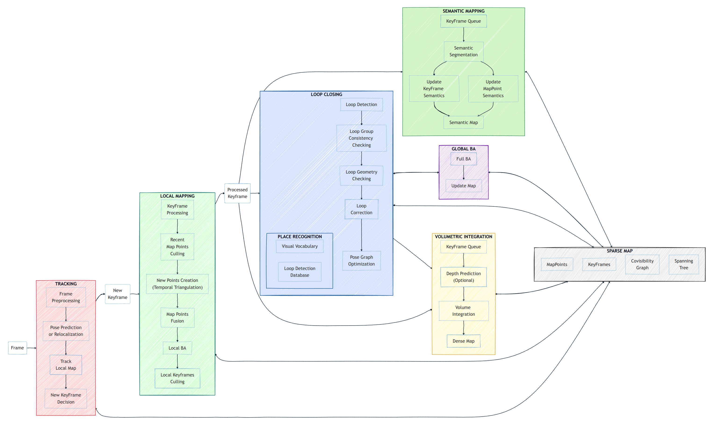 

This figure illustrates the SLAM workflow, which is composed of **six main parallel processing modules**:

- **Tracking**: estimates the camera pose for each incoming frame by extracting and matching local features to the local map, followed by minimizing the reprojection error through motion-only Bundle Adjustment (BA). It includes components such as pose prediction (or relocalization), feature tracking, local map tracking, and keyframe decision-making.

- **Local Mapping**: updates and refines the local map by processing new keyframes. This involves culling redundant map points, creating new points via temporal triangulation, fusing nearby map points, performing Local BA, and pruning redundant local keyframes.

- **Loop Closing**: detects and validates loop closures to correct drift accumulated over time. Upon loop detection, it performs loop group consistency checks and geometric verification, applies corrections, and then launches Pose Graph Optimization (PGO) followed by a full Global Bundle Adjustment (GBA). Loop detection itself is delegated to a parallel process, the *Loop Detector*, which operates independently for better responsiveness and concurrency.

- **Global Bundle Adjustment**: triggered by the Loop Closing module after PGO, this step globally optimizes the trajectory and the sparse structure of the map to ensure consistency across the entire sequence.

- **Volumetric Integration**: uses the keyframes, with their estimated poses and back-projected point clouds, to reconstruct a dense 3D map of the environment. This module optionally integrates predicted depth maps and maintains a volumetric representation such as a TSDF or Gaussian Splatting-based volume.

- **Semantic Mapping**: enriches the SLAM map with dense semantic information by applying pixel-wise segmentation to selected keyframes. Semantic predictions are fused across views to assign semantic labels or descriptors to keyframes and map points. The module operates in parallel, consuming keyframes and associated image data from a queue, applying a configured semantic segmentation model, and updating the map with fused semantic features. This enables advanced downstream tasks such as semantic navigation, scene understanding, and category-level mapping.

The first four modules follow the established PTAM and ORB-SLAM paradigm. Here, the Tracking module serves as the front-end, while the remaining modules operate as part of the back-end.

In parallel, the system constructs two types of maps:
- The sparse map ${\cal M}_s = ({\cal K}, {\cal P})$, composed of a set of keyframes ${\cal K}$ and 3D points ${\cal P}$ derived from matched features.
- The volumetric/dense map ${\cal M}_v$, constructed by the Volumetric Integration module, which fuses back-projected point clouds from the keyframes ${\cal K}$ into a dense 3D model.

To ensure consistency between the sparse and volumetric representations, the volumetric map is updated or re-integrated whenever global pose adjustments occur (e.g., after loop closures).

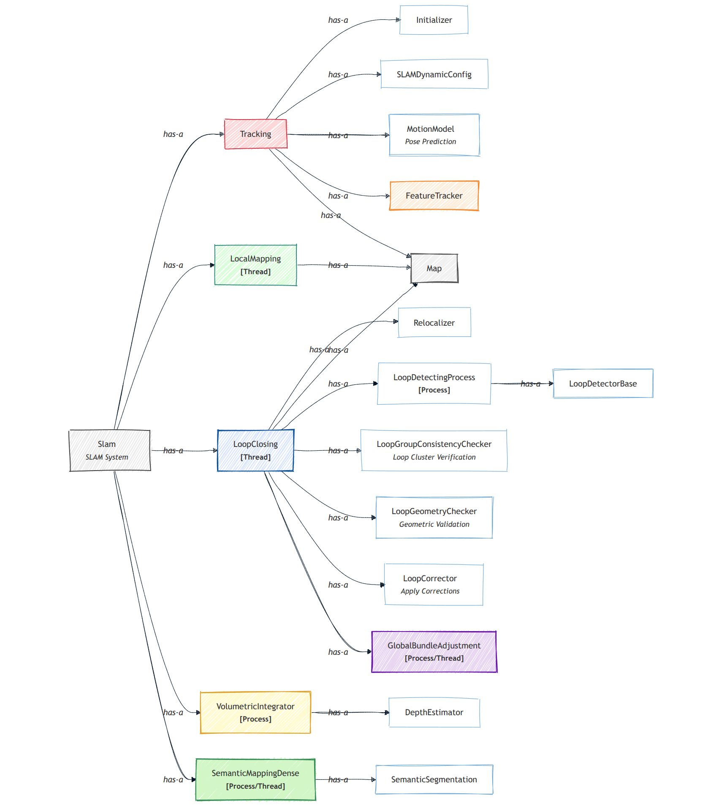 

This other figure details the internal components and interactions of the above modules. In certain cases, **processes** are employed instead of **threads**. This is due to Python's Global Interpreter Lock (GIL), which prevents concurrent execution of multiple threads in a single process. The use of multiprocessing circumvents this limitation, enabling true parallelism at the cost of some inter-process communication overhead (e.g., via pickling). For an insightful discussion, see this related [post](https://www.theserverside.com/blog/Coffee-Talk-Java-News-Stories-and-Opinions/Is-Pythons-GIL-the-software-worlds-biggest-blunder).

### Main Indirect SLAM Components

#### Feature Tracker

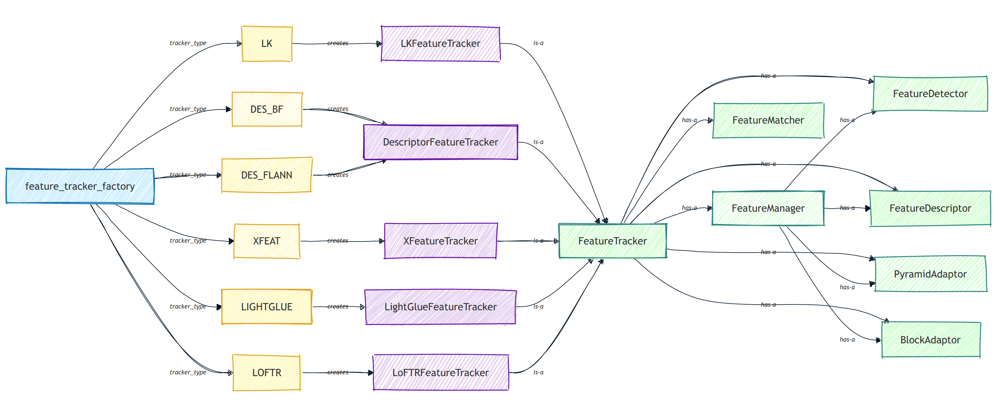 

The *Feature Tracker* consists of the following key sub-components:

- *Feature Manager*: Manages local feature operations. It includes the `FeatureDetector`, `FeatureDescriptor`, and adaptors for pyramid management and image tiling.  
  - *Feature Detector*: Identifies salient and repeatable keypoints in the image—such as corners or blobs, that are likely to be robust under viewpoint and illumination changes.  
  - *Feature Descriptor*: Computes a distinctive descriptor for each detected keypoint, capturing its local appearance to enable robust matching across frames. Examples include `ORB2`, `SIFT`, and `SuperPoint`.

- *Feature Matcher*: Establishes correspondences between features in successive frames (or stereo pairs) by comparing their descriptors or directly inferring matches from image content. Matching can be performed using brute-force, k-NN with ratio test, or learned matching strategies. Refer to the section [Feature Matcher](#feature-matcher) below for more details.

See the section [Supported local features](../README.md#supported-local-features) for a list of supported feature detectors and descriptors.

The last diagram above presents the architecture of the *Feature Tracker* system. It is organized around a `feature_tracker_factory`, which instantiates specific tracker types such as `LK`, `DES_BF`, `DES_FLANN`, `XFEAT`, `LIGHTGLUE`, and `LOFTR`. Each tracker type creates a corresponding implementation (e.g., `LKFeatureTracker`, `DescriptorFeatureTracker`, etc.), all of which inherit from a common `FeatureTracker` interface.

The `FeatureTracker` class is composed of several key sub-components, including a `FeatureManager`, `FeatureDetector`, `FeatureDescriptor`, `PyramidAdaptor`, `BlockAdaptor`, and `FeatureMatcher`. The `FeatureManager` itself encapsulates instances of the detector, descriptor, and adaptors, highlighting the modular and reusable design of the tracking pipeline.

#### Feature Matcher

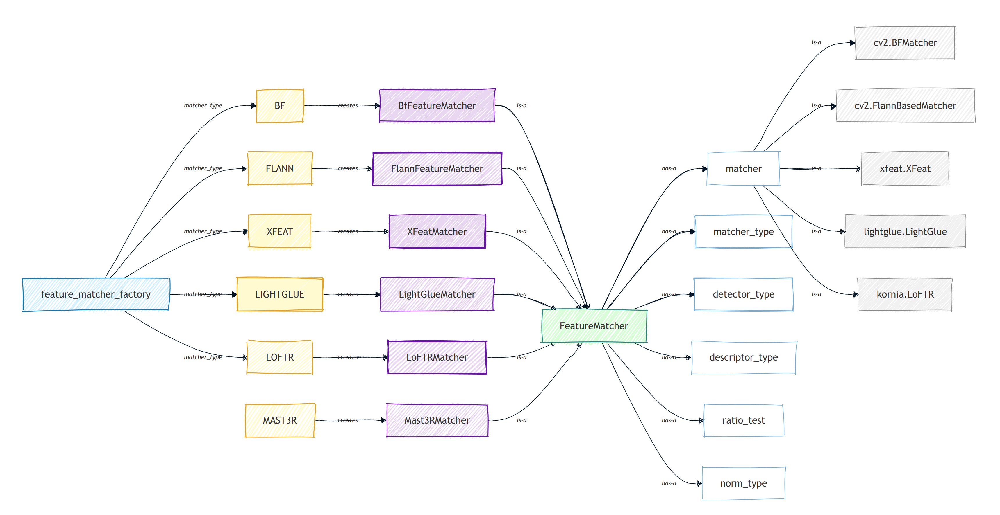 

This last diagram illustrates the architecture of the *Feature Matcher* module. At its core is the `feature_matcher_factory`, which instantiates matchers based on a specified `matcher_type`, such as `BF`, `FLANN`, `XFEAT`, `LIGHTGLUE`, and `LOFTR`. Each of these creates a corresponding matcher implementation (e.g., `BfFeatureMatcher`, `FlannFeatureMatcher`, etc.), all inheriting from a common `FeatureMatcher` interface.

The `FeatureMatcher` class encapsulates several configuration parameters and components, including the matcher engine (`cv2.BFMatcher`, `FlannBasedMatcher`, `xfeat.XFeat`, etc.), as well as the `matcher_type`, `detector_type`, `descriptor_type`, `norm_type`, and `ratio_test` fields. This modular structure supports extensibility and facilitates switching between traditional and learning-based feature matching backends.

The section [Supported matchers](../README.md#supported-matchers) reports a list of supported feature matchers.

#### Loop Detector 

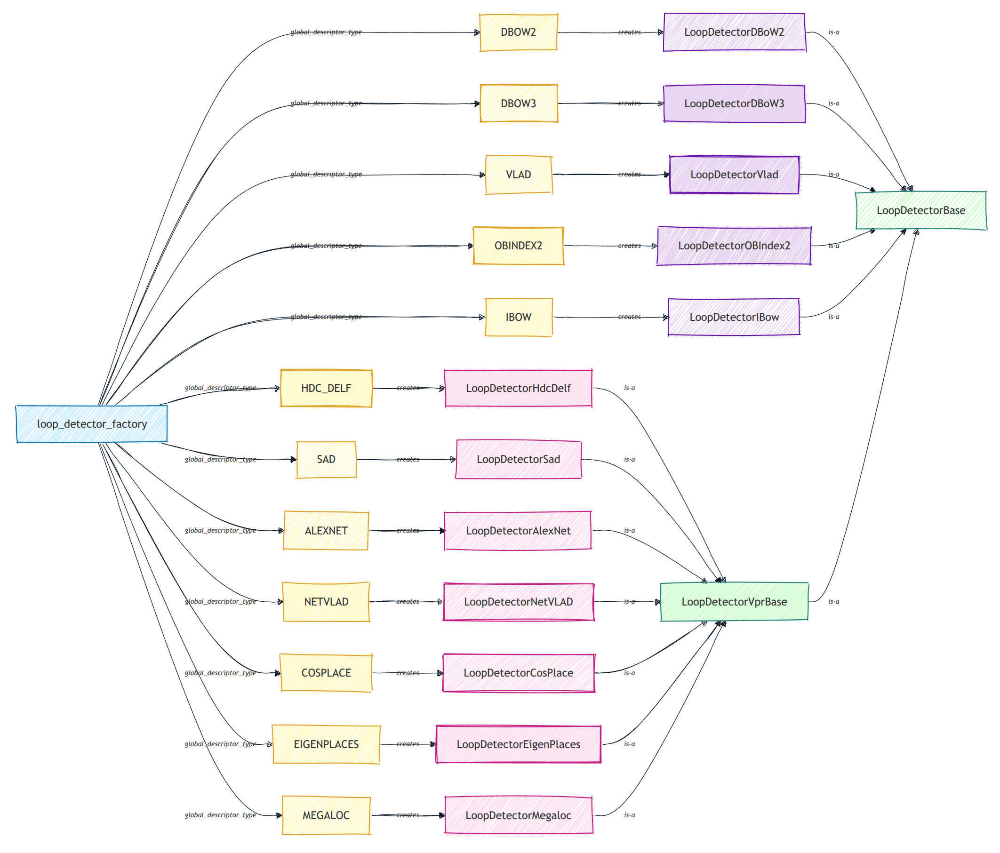 

This diagram shows the architecture of the *Loop Detector* component. A central `loop_detector_factory` instantiates loop detectors based on the selected `global_descriptor_type`, which may include traditional descriptors (e.g., `DBOW2`, `VLAD`, `IBOW`) or deep learning-based embeddings (e.g., `NetVLAD`, `CosPlace`, `EigenPlaces`, `Megaloc`, `SALAD`, `BoQ`).

Each descriptor type creates a corresponding loop detector implementation (e.g., `LoopDetectorDBoW2`, `LoopDetectorNetVLAD`), all of which inherit from a base class hierarchy. Traditional methods inherit directly from `LoopDetectorBase`, while deep learning-based approaches inherit from `LoopDetectorVprBase`, which itself extends `LoopDetectorBase`. This design supports modular integration of diverse place recognition techniques within a unified loop closure framework.

The section [Supported loop closing methods](../README.md#supported-global-descriptors-and-local-descriptor-aggregation-methods) reports a list of supported loop closure methods with the adopted global descriptors and local descriptor aggregation methods.

The same loop detectors are used by the [direct SLAM loop closing](#loop-closing-on-descriptor-keyframes).

#### Depth Estimator 

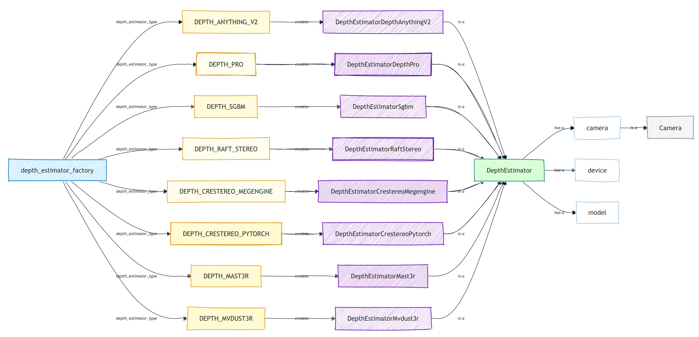 

The last diagram illustrates the architecture of the *Depth Estimator* module. A central `depth_estimator_factory` creates instances of various depth estimation backends based on the selected `depth_estimator_type`, including both traditional and learning-based methods such as `DEPTH_SGBM`, `DEPTH_RAFT_STEREO`, `DEPTH_ANYTHING_V2`, `DEPTH_MAST3R`, and `DEPTH_MVDUST3R`.

Each estimator type instantiates a corresponding implementation (e.g., `DepthEstimatorSgbm`, `DepthEstimatorCrestereoMegengine`, etc.), all inheriting from a common `DepthEstimator` interface. This base class encapsulates shared dependencies such as the `camera`, `device`, and `model` components, allowing for modular integration of heterogeneous depth estimation techniques across stereo, monocular, and multi-view pipelines.

The section [Supported depth prediction models](../README.md#supported-depth-prediction-models) provides a list of supported depth estimation/prediction models.

#### Volumetric Integrator

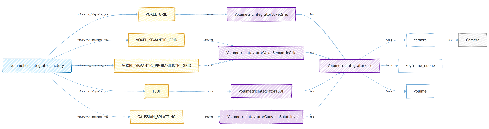 

This diagram illustrates the structure of the *Volumetric Integrator* module. At its core, the `volumetric_integrator_factory` generates specific volumetric integrator instances based on the selected `volumetric_integrator_type`, such as `VOXEL_GRID`, `VOXEL_SEMANTIC_GRID`, `VOXEL_SEMANTIC_PROBABILISTIC_GRID`, `TSDF` and `GAUSSIAN_SPLATTING`.

Each type instantiates a dedicated implementation (e.g., `VolumetricIntegratorVoxelGrid`, `VolumetricIntegratorVoxelSemanticGrid`, `VolumetricIntegratorTSDF`, `VolumetricIntegratorGaussianSplatting`), which inherits from a common `VolumetricIntegratorBase`. This base class encapsulates key components including the `camera`, a `keyframe_queue`, and the `volume`, enabling flexible integration of various 3D reconstruction methods within a unified pipeline.

The section [Supported volumetric mapping methods](../README.md#supported-volumetric-mapping-methods) provides a list of supported volume integration methods.

#### Semantic Mapping

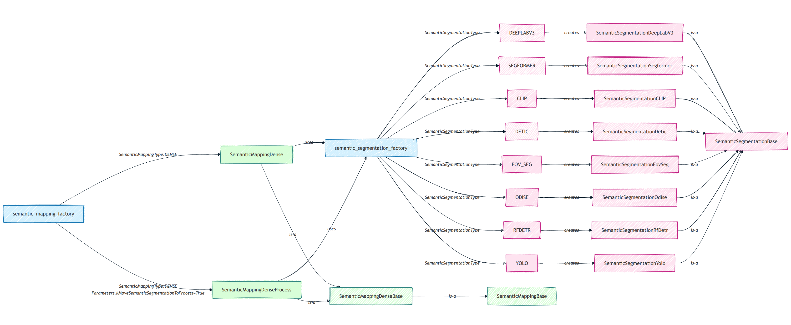 

This diagram outlines the architecture of the *Semantic Mapping* module. At its core is the `semantic_mapping_factory`, which creates semantic mapping instances according to the selected `semantic_mapping_type`. Currently, the supported type is `DENSE`, which instantiates either the `SemanticMappingDense` class or the `SemanticMappingDenseProcess` class if `Parameters.kSemanticMappingMoveSemanticSegmentationToSeparateProcess=True`. Both these classes extend `SemanticMappingDenseBase` and runs asynchronously in a dedicated thread to process keyframes as they become available. In particular, the `SemanticMappingDenseProcess` class offloads semantic segmentation inference to a separate process, thereby making better use of CPU core parallelism.

`SemanticMappingDense` and `SemanticMappingDenseProcess` integrate semantic information into the SLAM map by leveraging per-keyframe predictions from a semantic segmentation model. The segmentation model is instantiated via the `semantic_segmentation_factory`, based on the selected `semantic_segmentation_type`. Supported segmentation backends include `DEEPLABV3`, `SEGFORMER`, `CLIP`, `EOV_SEG`, `DETIC`, `RFDETR`, `YOLO`, and `ODISE`, each of which corresponds to a dedicated class (`SemanticSegmentationDeepLabV3`, `SemanticSegmentationSegformer`, `SemanticSegmentationCLIP`, `SemanticSegmentationEovSeg`, `SemanticSegmentationDetic`, `SemanticSegmentationRfDetr`, `SemanticSegmentationYolo`, and `SemanticSegmentationOdise`) inheriting from the shared `SemanticSegmentationBase`.

The system supports multiple semantic feature representations - such as categorical labels, probability vectors, and high-dimensional feature embeddings - and fuses them into the map using configurable methods like count-based fusion, Bayesian fusion, or feature averaging.

This modular design decouples semantic segmentation from mapping logic, enabling flexible combinations of segmentation models, datasets (e.g., NYU40, Cityscapes), and fusion strategies. It also supports customization via configuration files or programmatic APIs for dataset-specific tuning or deployment.

The section [Supported semantic segmentation methods](../README.md#supported-semantic-segmentation-methods) provides a list of supported semantic segmentation methods.

This paper provides a presentation of the first version of sparse semantic mapping module.
*["Semantic pySLAM: Unifying semantic mapping approaches under the same framework"](./pyslam-semantic.pdf)*, David Morilla-Cabello, Eduardo Montijano  

---

## Direct and Semi-Direct SLAM

[`main_slam_direct.py`](../main_slam_direct.py) runs a separate SLAM pipeline that exists only in C++ ([`cpp/core/slam/direct`](../cpp/core/slam/direct/README.md)) and requires `USE_CPP_CORE`. Tracking and local mapping are descriptor-free: correspondences come from image intensities on raw pixels (grid FAST or GFTT corners, pyramidal Lucas-Kanade, photometric patch alignment). Descriptors are extracted only on separate keyframes, for the optional loop closing. The pipeline shares the configuration, datasets, camera factory, viewers and feature-trail renderer of the indirect pipeline. Dense and semantic mapping are not provided.

The [Direct SLAM guide](./direct_slam.md) gives the tracking/recovery and BA flowcharts, the depth filter, camera restrictions, parameters and run commands. This section describes the architecture.

### Direct SLAM Workflow and Components

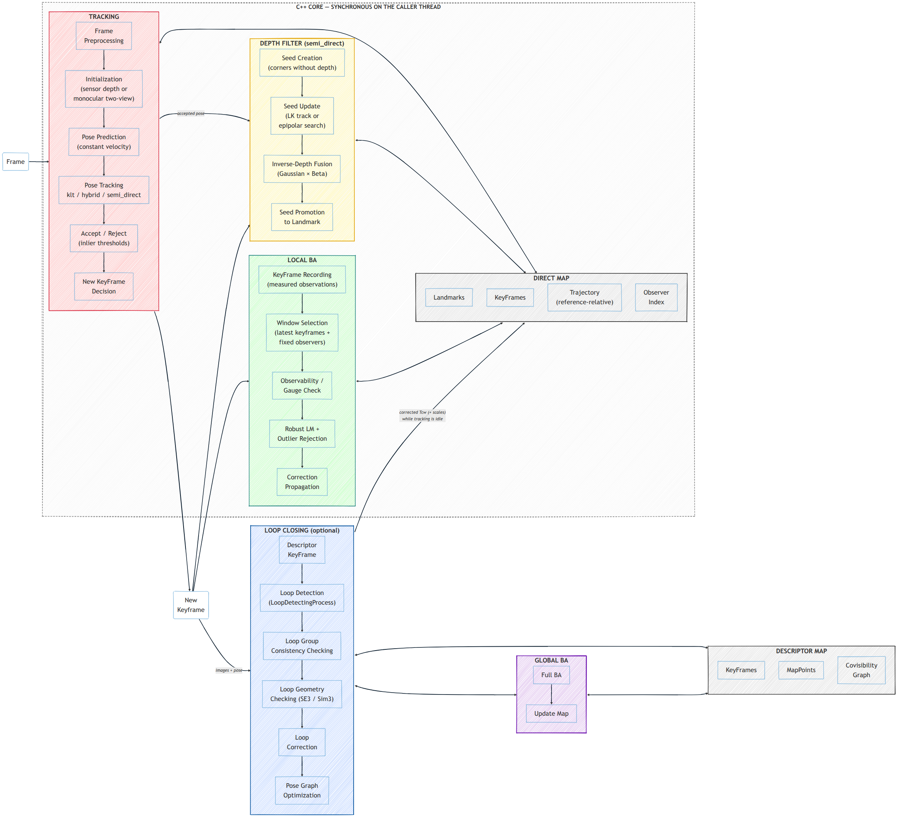 

The workflow has four modules. Unlike the indirect pipeline, the first three run **synchronously on the caller's thread**, inside one `DirectSlam.track()` call. The Python binding releases the GIL during this call.

- **Tracking**: initializes the map from sensor depth (stereo or RGBD) or, for monocular `semi_direct`, from a two-view essential-matrix geometry. It predicts each pose with a constant-velocity model and estimates it with the configured mode (`klt`, `hybrid` or `semi_direct`). The pose is then accepted or rejected from its inlier count. A rejected frame keeps the last accepted reference for recovery. A low live-track count or the maximum keyframe interval triggers a new keyframe.

- **Depth Filter** (`semi_direct` only): corners without a depth measurement become inverse-depth seeds. Each accepted frame updates them by an LK track or, once that is lost, an epipolar search, and fuses the measurement with the SVO Gaussian × Beta model. Converged seeds become landmarks with an inverse-depth prior, which also fixes the monocular scale.

- **Local BA**: records the measured keyframe observations and jointly optimizes the latest keyframes and their landmarks. Older keyframes that observe active landmarks stay fixed. Unobservable windows are skipped. Robust Levenberg-Marquardt with outlier rejection is followed by validation. The accepted corrections are propagated to non-keyframe poses and live tracks.

- **Loop Closing** (optional): reuses the indirect pipeline's `LoopClosing` thread on separately extracted descriptor keyframes. It runs loop detection, group consistency and geometric checks (SE3, or Sim(3) for monocular), loop correction, pose-graph optimization and global BA on a descriptor map. The corrected poses (with per-keyframe scales for monocular) are written back into the direct map while tracking is idle.

The system therefore keeps two maps:
- The direct map, which archives keyframes, persistent landmarks, reference-relative trajectory poses and an observer index.
- The descriptor map, a standard `Map` of descriptor keyframes and points, used only by loop closing. Its keyframes are aligned to the direct keyframes.

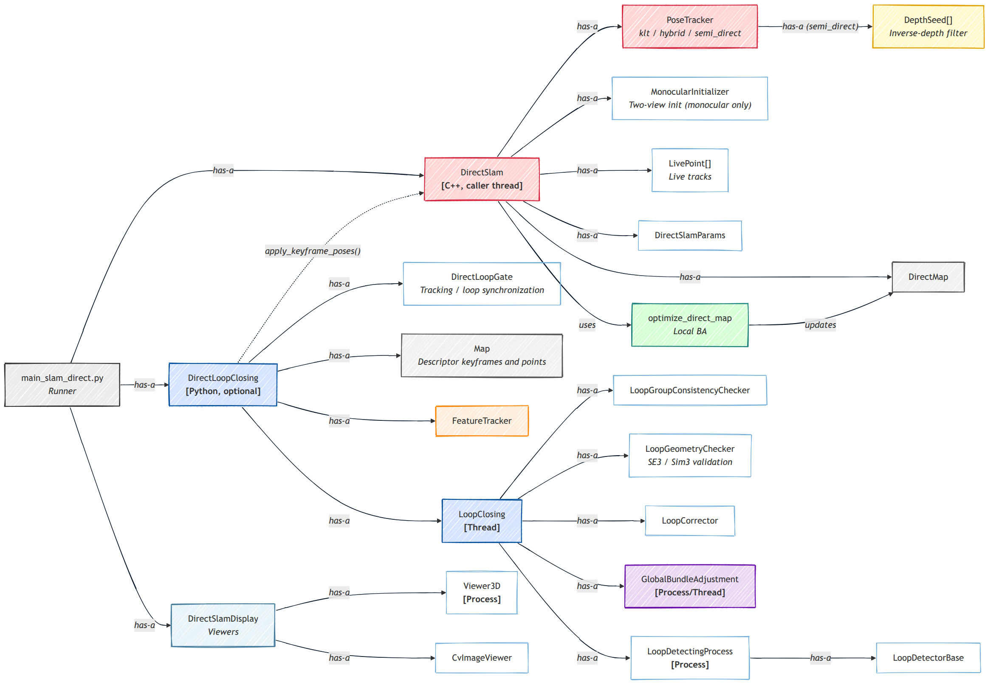 

This figure shows the main classes. `DirectSlam` is the C++ system object: it owns the mode-specific `PoseTracker`, the `MonocularInitializer`, the `DirectMap`, the live tracks and the parameters, and calls `optimize_direct_map` for local BA. On the Python side, `DirectLoopClosing` adapts the direct map to the standard `LoopClosing` thread. A `DirectLoopGate` lets the tracking thread and loop closing take turns. `DirectSlamDisplay` copies map snapshots after each `track()` call and feeds the shared `Viewer3D` and `CvImageViewer`.

### Main Direct SLAM Components

#### Pose Tracker

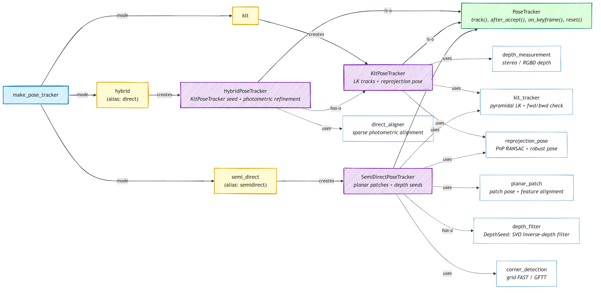 

This diagram shows the architecture of the *Pose Tracker*. `make_pose_tracker` creates one implementation per `DIRECT_SLAM.mode`. All implementations inherit from the `PoseTracker` interface:

- `KltPoseTracker` (`klt`): pyramidal LK tracks with a forward/backward check, then PnP RANSAC and robust reprojection-pose refinement. This mode is indirect: pose is estimated from reprojection error.
- `HybridPoseTracker` (`hybrid`, alias `direct`): owns a `KltPoseTracker` for the geometric seed, then applies sparse photometric refinement (`direct_aligner`) when it agrees with the geometric tracks. If the geometric seed fails, it can recover with photometric-only tracking.
- `SemiDirectPoseTracker` (`semi_direct`): SVO-style alignment of fronto-parallel planar patches against the reference keyframe, then per-feature 2D alignment and the reprojection pose. It owns the depth seeds and is the only mode that accepts monocular input.

`DirectSlam` keeps everything common to all modes: input checks, initialization, the accept/reject decision, live-track bookkeeping, keyframes and local BA. The trackers plug in through `track()`, `after_accept()`, `on_keyframe()` and `reset()`. The building blocks on the right are free functions grouped by folder: LK correspondences under `lk/`, photometric code under `photometric/`, and shared geometry under `geometry/` and `features/`. Each mode has its own folder (`klt/`, `hybrid/`, `semi_direct/`).

#### Direct Map and Local BA

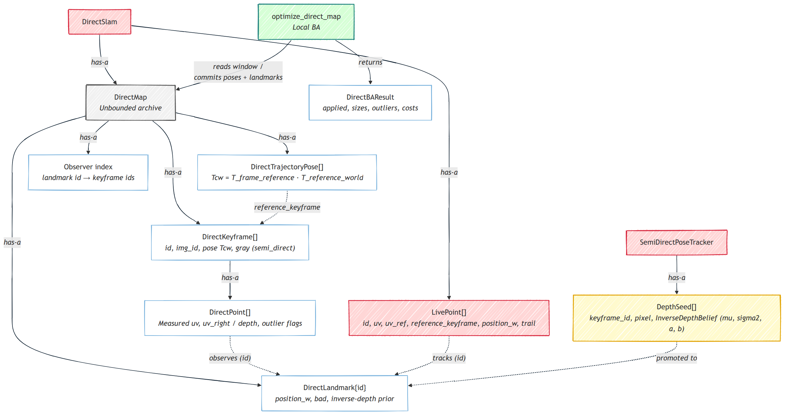 

This diagram shows the data model of the direct map and the objects that update it. `DirectMap` is an unbounded archive. Only the backend graph is limited to the latest keyframes:

- `DirectKeyframe` stores the pose and the immutable measurements of its observations (`DirectPoint`: left pixel, right pixel or depth, per-channel outlier flags). `semi_direct` also keeps the gray image while the keyframe is the tracking reference or owns seeds.
- `DirectLandmark` stores the optimized world position shared by all observations of the same ID. In monocular `semi_direct`, it also stores the inverse-depth prior of the seed it was promoted from, which acts as the scale gauge in BA.
- `DirectTrajectoryPose` stores each accepted frame relative to its reference keyframe, so non-keyframe poses follow BA and loop corrections.
- `LivePoint` is a track that is currently followed, linked to a landmark and to a reference keyframe.

`optimize_direct_map` reads the active window and commits the optimized poses and landmarks only after validation. It reports the outcome in a `DirectBAResult`.

#### Loop Closing on Descriptor Keyframes

Loop closing reuses the indirect components shown in the [components diagram above](#direct-slam-workflow-and-components): `LoopClosing`, `LoopDetectingProcess` with any [Loop Detector](#loop-detector), `LoopGroupConsistencyChecker`, `LoopGeometryChecker`, `LoopCorrector` and `GlobalBundleAdjustment`. `FeatureTrackerConfig` and `LoopDetectionConfig` select the local and global features, as in `main_slam.py`. An LK tracker is rejected because loop detection needs descriptors.

For each new direct keyframe, the tracking thread registers an empty descriptor keyframe and queues its images. `LoopDetectingProcess` extracts the features and returns them to the `LoopClosing` thread, which creates the descriptor map points from the keyframe's latest direct pose. Monocular keyframes are handed over a few keyframes late, so that the depth seeds promoted since are included; they take the 3D positions of nearby direct landmarks, triangulate the remaining matches, and fuse points with their recent keyframes. After a correction, `DirectSlam.apply_keyframe_poses(poses, scales)` moves every landmark, trajectory pose and seed with its anchor keyframe.

See [Comparison with the Main SLAM Pipeline](./direct_slam.md#comparison-with-the-main-slam-pipeline) for a feature-by-feature comparison of the two SLAM pipelines.

---

## C++ Core for Sparse SLAM

The system provides a modular **sparse-SLAM core**, implemented in **both Python and C++** (with custom pybind11 bindings), allowing users to switch between high-performance/speed and high-flexibility modes. The C++ core reimplements the sparse SLAM originally implemented in Python, exposing core SLAM classes (frames, keyframes, map points, maps, cameras, optimizers, tracking, and local mapping) to Python via pybind11.

The C++ implementation follows a streamlined design where all core data resides in C++, with Python serving as an interface layer. C++ classes mirror their Python counterparts, maintaining identical interfaces and data field names. The bindings support zero-copy data exchange (e.g., descriptors) and safe memory ownership across the Python/C++ boundary, leveraging automatic zero-copy sharing of NumPy array memory with C++ when possible. The C++ sparse-SLAM core is enabled by default (`USE_CPP_CORE = True` in `pyslam/config_parameters.py`); set it to `False`, or launch with `PYSLAM_USE_CPP=false`, to run the Python core.

A detailed overview of the C++ core architecture, design principles, and implementation details is provided in this [document](../cpp/core/slam/README.md). The C++ camera classes live in [`cpp/core/camera`](../cpp/core/camera/README.md), and the headers shared by `camera`, `slam` (including `slam/direct`) and `semantics` live in [`cpp/core/common`](../cpp/core/common/README.md); both are compiled into `cpp_core`.

The [direct SLAM pipeline](#direct-and-semi-direct-slam) is compiled into the same `cpp_core` module ([`cpp/core/slam/direct`](../cpp/core/slam/direct/README.md)), as a subfolder of the sparse-SLAM core. Unlike the sparse-SLAM core, it has no Python counterpart, so `main_slam_direct.py` requires `USE_CPP_CORE`.

---

## Scene from Views

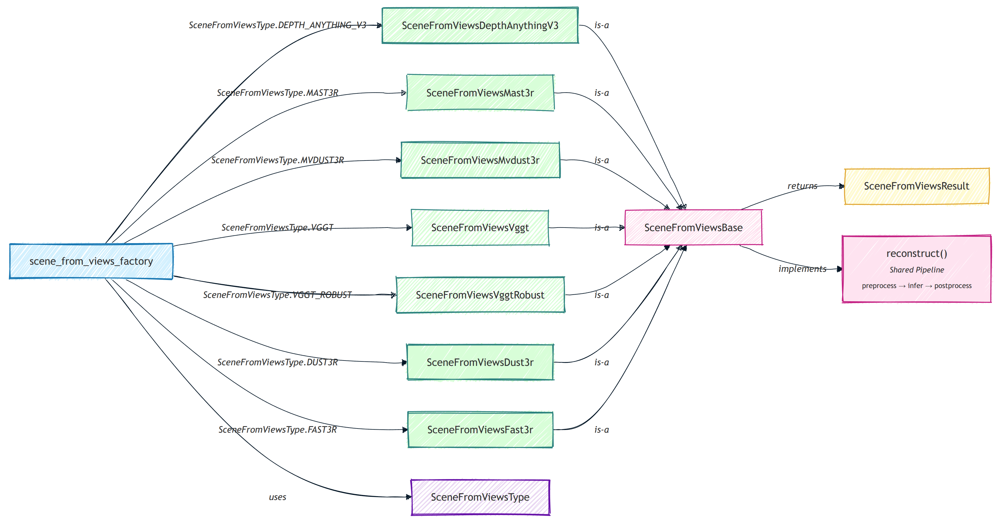 

This diagram illustrates the architecture of the *Scene from Views* module, which provides a unified interface for 3D scene reconstruction from multiple views. At its core, the `scene_from_views_factory` instantiates specific reconstruction models based on the selected `SceneFromViewsType`, such as `DUST3R`, `MAST3R`, `DEPTH_ANYTHING_V3`, `MVDUST3R`, and `VGGT`.

Each type creates a corresponding implementation (e.g., `SceneFromViewsDust3r`, `SceneFromViewsMast3r`, `SceneFromViewsDepthAnythingV3`, `SceneFromViewsMvdust3r`, `SceneFromViewsVggt`), all inheriting from a common `SceneFromViewsBase`. This base class implements a unified three-step reconstruction pipeline: `preprocess_images()` prepares input images for the specific model, `infer()` runs model inference, and `postprocess_results()` converts raw model output to a standardized `SceneFromViewsResult` format containing merged point clouds, meshes, camera poses, and optional depth maps or intrinsics.

The module supports both pairwise models (DUSt3R, MASt3R) that process image pairs and perform global alignment, as well as multi-view models (MV-DUSt3R, VGGT) that process multiple views simultaneously in a single forward pass. This modular design enables flexible integration of diverse 3D reconstruction techniques while maintaining a consistent API across different model architectures.

For more details, refer to the [Scene from Views documentation](./scene_from_views.md).

---

## Shared Infrastructure

### Camera models

The camera exposes projection, unprojection, and analytic projection Jacobians. Omitting `Camera.type` keeps the linear pinhole used by the existing datasets: detected points are undistorted, and projection does not apply distortion. `kannala_brandt4`, `pinhole_radtan8`, and `double_sphere` project detected pixels directly. Mono, RGB-D, and calibrated native stereo use the corresponding model-aware factors; rectified stereo retains pinhole geometry, and Sim(3) uses undistorted coordinates.

The model parameters, pixel conventions, and factor layout are described in [Camera models](../cpp/modules/camera_models/README.md). The C++ implementation used by `cpp_core` is in [`cpp/core/camera`](../cpp/core/camera/README.md).

New-model mapping uses raw-pixel measurements consistently. RGB-D and calibrated native stereo use model-aware native factors, and serialization preserves camera subclasses and rig extrinsics. Pinhole observations retain their native optimizer paths. See [TUM-VI](./tum-vi.md) for native and rectified modes, and [Camera models](../cpp/modules/camera_models/README.md#tests) for the regression suite.

The direct SLAM pipeline uses the same camera classes. All its modes accept an undistorted pinhole or a raw-pixel camera and track in the distorted pixels; for monocular or RGBD input, the runner undistorts the images of a distorted pinhole; see [Direct SLAM](./direct_slam.md#quick-start) for the supported sensors.

### Classic and learned local features

pySLAM supports two families of local features. *Classic* features (ORB, ORB2, SIFT, AKAZE, BRISK, FAST, ...) are hand-designed algorithms that come with OpenCV or with the compiled ORB-SLAM2 extractor: they need no model weights and are always available. *Learned* features (SuperPoint, ALIKED, DISK, XFeat, DeDoDe v2, RDD, ...) are neural networks: each has a pyslam wrapper that loads the network and its weights.

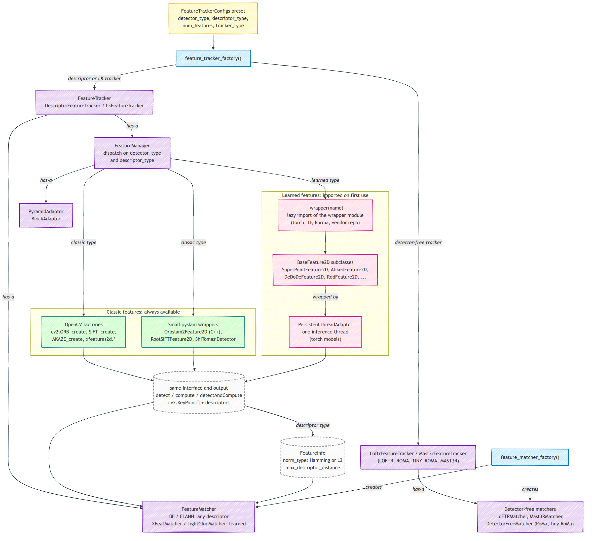

The diagram shows how both families go through the same path:

- A `FeatureTrackerConfigs` preset names the detector, the descriptor and the tracker type. `feature_tracker_factory` creates the `FeatureTracker`, which owns a `FeatureManager` (extraction) and a `FeatureMatcher` (matching).
- The `FeatureManager` looks at `detector_type` and `descriptor_type` and sets the options of each feature (pyramid, non-maximum suppression, color input, ...). It takes the class of the feature from the visual model registry (`load_constructor()`, see [Visual model catalog](#visual-model-catalog)) and imports it only on first use. For a classic feature, the class is an OpenCV factory function (e.g. `cv2.ORB_create`) or one of a few small pyslam wrappers (`Orbslam2Feature2D`, `RootSIFTFeature2D`, `ShiTomasiDetector`). For a learned feature, it is a pyslam wrapper, so torch, TensorFlow or a vendor repository are loaded only when a learned feature is actually selected. Learned wrappers derive from `BaseFeature2D`, and torch-based ones run on a dedicated inference thread (`PersistentThreadAdaptor`).
- Both families expose the same `detect` / `compute` / `detectAndCompute` methods and return the same output: a list of `cv2.KeyPoint` and an array of descriptors. From this point on, the rest of the pipeline treats them the same way.
- `FeatureInfo` tells the matcher how to compare the descriptors: Hamming distance for binary descriptors (e.g. ORB), L2 distance for float descriptors (e.g. SIFT and the learned ones), plus a calibrated maximum descriptor distance. Its tables are built from the registry. BF and FLANN match any descriptor; XFeat and LightGlue are learned matchers for their own features.
- Detector-free trackers (LoFTR, MASt3R, RoMa, tiny-RoMa) take a different route: a single `DetectorFreeFeatureTracker` drives them, and its matcher computes matched keypoints directly from the two images. Its `FeatureManager` is built with the `NONE` detector and descriptor, so it loads no network and no keypoints are extracted on single images.

### Visual model catalog

The [`pyslam.visual_models` catalog](./visual_features.md#model-catalog-and-inspection-tools) is a list of every visual model integrated in pySLAM: local features, pair matchers and global descriptors for loop closure. It holds only metadata (strings), so reading it never loads a neural network or an inference framework. It is the single place where a model is declared: the `FeatureManager` takes its classes from it, `FeatureInfo` is built from its descriptor metrics, and `feature_tracker_factory` uses its `detector_free` flag. The same records are used to inspect models, install their weights and test the integrations.

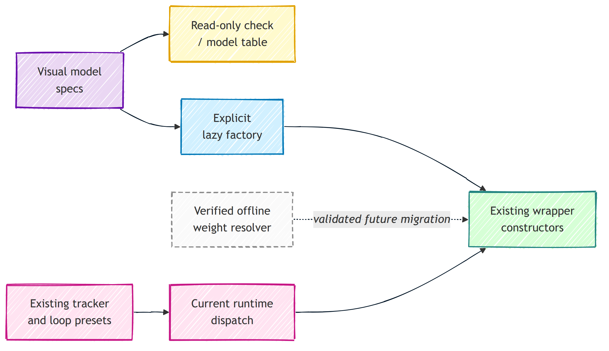

The classes in the diagram, in simple terms:

- `ModelSpec` (in `model_registry.py`) is the record of one model: its name, its kind (`local_feature`, `pair_matcher` or `global_descriptor`), the `module:symbol` of its class, its dependency group (`core`, `dense_matchers`, `tf_models`, `vpr`), its capabilities (e.g. whether it produces per-keypoint descriptors, or is detector-free), its descriptor metric (`norm`, `max_descriptor_distance`), whether its descriptor needs its own detector (`joint`), and, for self-installing models, the arguments used to prefetch it (`install_kwargs`). The registry holds all records and answers queries such as `get_spec()`, `list_models()` and `spec_for_enum()`. A record can also report the model's provenance and license notes (`legacy_sources.json`).
- The factory (`get_local_feature()`, `get_pair_matcher()`, `get_global_descriptor()`) builds a model from its name: it looks up the record, imports the class only at that moment (`load_constructor()`) and constructs it. The `FeatureManager` and the installer use `load_constructor()` too. If an optional package is missing, it raises `ModelUnavailable` with the dependency group to install.
- The weight resolver (`WeightResolver`, `WeightSource`, `verify()` in `weights.py`) downloads model weights from a pinned source (Hugging Face commit, torch.hub, HTTPS), stores them in a cache and checks their SHA-256 checksums listed in `verified_weights.json`. It also supports an offline mode (`PYSLAM_OFFLINE=1`). RDD uses it to verify its weights, and the torch.hub global descriptors (SALAD, BoQ) use its offline flag.
- The installer (`install.py`) prefetches the models integrated through pinned sources, i.e. the records with `install_kwargs`: it constructs each model once through the factory, which downloads its code and weights, and then verifies the checksums.
- The command-line tool (`python -m pyslam.visual_models`, also called by `scripts/install_visual_model.sh`) ties these together: `check` and `table` read the registry, `install` runs the installer, and `prefetch` fetches one registered weight file through the resolver.
