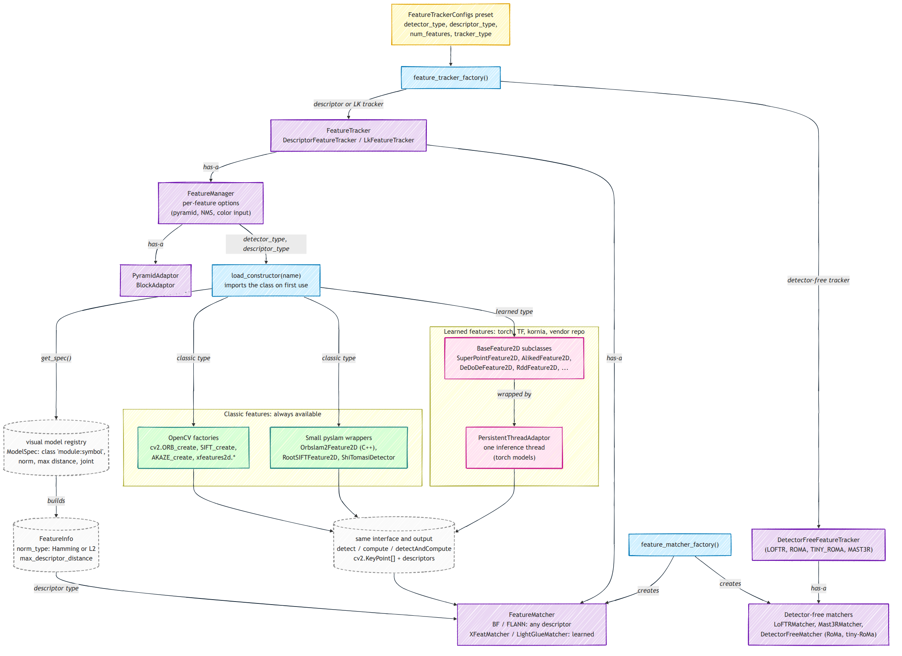
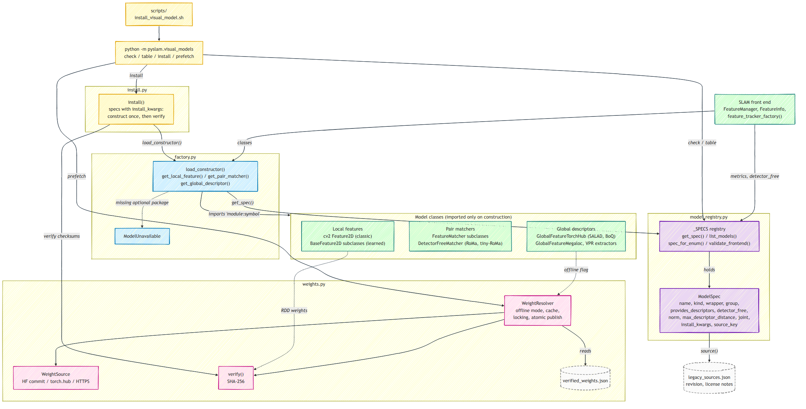

# Visual Features, Matchers and Loop-Closure Descriptors

This page describes how pySLAM manages its visual models: the local features (detectors and descriptors) used by tracking and mapping, the matchers that associate them across images, and the global descriptors used for loop closure. It covers how to select a method, how classic and learned models are loaded, how to install model weights, the runtime and acceleration options, and the model catalog used to inspect every integration.

<!-- TOC -->

- [Visual Features, Matchers and Loop-Closure Descriptors](#visual-features-matchers-and-loop-closure-descriptors)
  - [Overview](#overview)
  - [Quick start](#quick-start)
  - [How classic and learned features are managed](#how-classic-and-learned-features-are-managed)
  - [Local features](#local-features)
    - [DeDoDe v2](#dedode-v2)
    - [RDD](#rdd)
  - [Matchers](#matchers)
    - [Detector-free matchers: RoMa and tiny-RoMa](#detector-free-matchers-roma-and-tiny-roma)
  - [Loop-closure descriptors](#loop-closure-descriptors)
  - [Runtime performance](#runtime-performance)
    - [Lazy imports and heap tuning](#lazy-imports-and-heap-tuning)
    - [Persistent inference threads](#persistent-inference-threads)
    - [Vectorized keypoint conversion](#vectorized-keypoint-conversion)
  - [Optional accelerations](#optional-accelerations)
  - [Installing models](#installing-models)
  - [Model catalog and inspection tools](#model-catalog-and-inspection-tools)
  - [Adding a new method](#adding-a-new-method)
  - [Evaluated and not integrated](#evaluated-and-not-integrated)
  - [Validation and benchmarking (developer notes)](#validation-and-benchmarking-developer-notes)
  - [Model catalog](#model-catalog)

<!-- /TOC -->

## Overview

pySLAM groups its visual models in three kinds, which mirror the three kinds of the [model catalog](#model-catalog):

| Kind | Role | Classic methods | Learned methods | Selected with |
| --- | --- | --- | --- | --- |
| Local feature (`local_feature`) | detect keypoints and compute one descriptor per keypoint | ORB, ORB2, SIFT, ROOT_SIFT, SURF, AKAZE, KAZE, BRISK, FAST, Shi-Tomasi, ... (OpenCV and ORB-SLAM2 extractors) | SuperPoint, ALIKED, DISK, XFeat, R2D2, D2-Net, KeyNet, DeDoDe v2, RDD, ... | `FeatureTrackerConfigs` |
| Pair matcher (`pair_matcher`) | associate the features of two images | brute force (BF), FLANN, LK optical flow | XFeat, LightGlue; detector-free LoFTR, MASt3R, RoMa, tiny-RoMa | the `tracker_type` of a `FeatureTrackerConfigs` preset |
| Global descriptor (`global_descriptor`) | describe a whole image for loop detection | bags of words and aggregations of local descriptors (DBoW2, DBoW3, OBIndex2, iBoW, VLAD), SAD | NetVLAD, CosPlace, EigenPlaces, MegaLoc, SALAD, BoQ, ... | `LoopDetectorConfigs` |

Speeds reported on this page are measured on an RTX A3000 laptop GPU.

## Quick start

Select a preset in `main_slam.py` / `main_vo.py` or in `config.yaml`:

```python
from pyslam.local_features.feature_tracker_configs import FeatureTrackerConfigs
from pyslam.loop_closing.loop_detector_configs import LoopDetectorConfigs

feature_tracker_config = FeatureTrackerConfigs.RDD        # or ORB2, SIFT, ALIKED, DEDODE, ...
loop_detection_config = LoopDetectorConfigs.SALAD         # or BOQ, MEGALOC, DBOW3, ...
```

Models integrated through pinned sources can be prefetched once; otherwise they are fetched on first use (see [Installing models](#installing-models)):

```bash
./scripts/install_visual_model.sh            # all self-installing models
./scripts/install_visual_model.sh RDD SALAD  # selected models
```

Detector-free matchers (RoMa, tiny-RoMa, LoFTR, MASt3R) return matched keypoints without per-keypoint descriptors, so they are meant for `main_vo.py`, `main_feature_matching.py`, initialization and verification, not for the descriptor-based map of `main_slam.py` (see the warning in `feature_tracker_configs.py`).

## How classic and learned features are managed

In short: a preset names a detector, a descriptor and a matcher; the `FeatureManager` builds the detector and the descriptor; classic ones come straight from OpenCV, learned ones are imported only when selected. Both expose the same `detect` / `compute` / `detectAndCompute` interface and return OpenCV keypoints plus a descriptor array, so the rest of the pipeline does not need to know which kind it is using.

<p align="center">

</p>

1. A `FeatureTrackerConfigs` preset is a plain dictionary (`detector_type`, `descriptor_type`, `num_features`, `num_levels`, `tracker_type`, ...). `feature_tracker_factory` turns it into a `FeatureTracker`, which owns a `FeatureManager` and a `FeatureMatcher`.
2. `FeatureManager` ([feature_manager.py](../pyslam/local_features/feature_manager.py)) chooses the extractor from `detector_type` and `descriptor_type`, and takes its class from the [model registry](#model-catalog-and-inspection-tools) (`load_constructor()`):
   - **Classic features** are created with the OpenCV factory functions of the locally built OpenCV (`cv2.ORB_create`, `cv2.SIFT_create`, `cv2.xfeatures2d.*`, ...). A few have small pyslam wrappers: `ORB2` (the ORB-SLAM2 extractor, compiled C++), `ROOT_SIFT` and Shi-Tomasi. Multi-scale detection uses each method's own pyramid or pyslam's `PyramidAdaptor`, and `BlockAdaptor` can spread keypoints over image tiles.
   - **Learned features** are pyslam wrappers deriving from `BaseFeature2D` ([feature_base.py](../pyslam/local_features/feature_base.py)), one file per method (`feature_superpoint.py`, `feature_aliked.py`, `feature_dedode.py`, `feature_rdd.py`, ...). The wrapper module, and with it torch, TensorFlow, kornia or the vendor repository, is imported the first time the feature is selected. Each wrapper loads its network and weights, converts the image to the network's input, and converts the network output back to `cv2.KeyPoint` arrays and float descriptors in original image coordinates. Torch-based detectors run on a long-lived inference thread (`PersistentThreadAdaptor`).
3. `FeatureInfo` ([feature_types.py](../pyslam/local_features/feature_types.py)) exposes, per descriptor, the norm (Hamming for binary descriptors such as ORB, L2 for float descriptors such as SIFT and the learned ones) and the calibrated `max_descriptor_distance` used by the SLAM front end. Its tables are built from the registry.
4. The `FeatureMatcher` matches descriptors: BF and FLANN work with classic and learned descriptors alike (using the norm from `FeatureInfo`); XFeat and LightGlue are learned matchers for their own features. Detector-free matchers (LoFTR, MASt3R, RoMa, tiny-RoMa) compute matches directly from the two images; one `DetectorFreeFeatureTracker` drives all of them. Its presets set `detector_type` and `descriptor_type` to `NONE`, so the tracker's `FeatureManager` loads no network and `detectAndCompute()` returns `(None, None)`.
5. Loop closure follows the same split: classic loop detectors aggregate the local descriptors of a keyframe into a bag of words (DBoW2/DBoW3, iBoW, OBIndex2) or a VLAD vector, while learned VPR detectors compute one global descriptor per image with a network, in the loop-detecting process.

The [`pyslam.visual_models`](#model-catalog-and-inspection-tools) catalog describes all these integrations (constructor, capabilities, descriptor metric, dependency group, license and weights) without importing any of them. It is the single source of truth: the `FeatureManager` resolves its classes from it, `FeatureInfo` is built from it, and the installer and the tests read it. Its classes are shown in the diagram of [Model catalog and inspection tools](#model-catalog-and-inspection-tools).

## Local features

Classic features need no model download. Learned features need their network weights, which are fetched on first use or by the model installer. A full list of the supported detectors and descriptors is in the [README](../README.md#supported-local-features), and the [model catalog](#model-catalog) table lists every local feature with its dependency group.

The DeDoDe v2 and RDD presets produce 2000 keypoints (the preset's `num_features`) with L2-normalized 256-D float descriptors, so they work with pyslam's BF/FLANN matchers, the descriptor-distance thresholds of the SLAM front end and the VPR loop detectors. Their `max_descriptor_distance` values were calibrated with the `main_feature_matching.py` rule (3 x sigma-MAD of matched descriptor distances) on 12 TUM/KITTI/EuRoC frame pairs.

### DeDoDe v2

`FeatureTrackerConfigs.DEDODE` uses the DeDoDe v2 detector (`L-C4-v2`: better under rotation, less keypoint clustering) and the DeDoDe `B` descriptor through kornia ([feature_dedode.py](../pyslam/local_features/feature_dedode.py)), so no extra package is needed. Keypoints are the deterministic top-k of the detector score map. `max_descriptor_distance` = 1.76. Code: kornia (Apache-2.0); method and weights: Parskatt/DeDoDe (MIT).

| Preset (GPU, 60-frame smoke) | KITTI stereo track ms | TUM RGB-D track ms | TUM ATE |
| --- | --- | --- | --- |
| DEDODE | 536 | 159 | 4.8 mm |
| ALIKED | 90 | 45 | 5.3 mm |

DeDoDe is accurate but heavy: extraction alone takes about 115 ms at 640x480 and 185 ms at 1241x376 (fp16 is already used internally). Like ALIKED, it does not initialize within the 60-frame EuRoC smoke run, while ORB2 does.

### RDD

`FeatureTrackerConfigs.RDD` uses RDD (Chen et al., CVPR 2025, `xtcpete/rdd`, Apache-2.0), a deformable-transformer detector and descriptor ([feature_rdd.py](../pyslam/local_features/feature_rdd.py)). The pinned source snapshot is loaded under a private module name (its own package is named `src`), so nothing is pip-installed. Multi-scale deformable attention runs in pure PyTorch unless the optional CUDA op is compiled. The weights (`weights/rdd.pth`, retrained by the authors after their data-leakage fix) come from the authors' Google Drive folder and are verified by SHA-256 before loading. `max_descriptor_distance` = 1.41.

On the calibration pairs RDD returns 338-678 ratio-test matches per KITTI pair (DeDoDe: 211-359) with a mean MAGSAC inlier rate of 0.86. Extraction takes about 290 ms at 640x480 and 410 ms at 1241x376. All RDD extractors on a device share one model and one inference thread (two stereo instances ran out of GPU memory at KITTI resolution). SLAM smoke runs (60 frames, C++ core): TUM 305 ms/frame, ATE 5.4 mm; KITTI stereo 968 ms/frame, ATE 0.195 m with all rows accepted. It is the most accurate learned preset on the KITTI smoke run.

## Matchers

`feature_matcher_factory` ([feature_matcher.py](../pyslam/local_features/feature_matcher.py)) creates one `FeatureMatcher` subclass per `matcher_type`; each implements `_match_impl()`, and BF/FLANN are implemented in the base class. Descriptor-based matchers (BF, FLANN, XFeat, LightGlue) match the descriptors produced by the `FeatureManager`; detector-free matchers (LoFTR, MASt3R, RoMa, tiny-RoMa) take two images and return matched keypoints directly. A list of supported matchers is in the [README](../README.md#supported-matchers).

### Detector-free matchers: RoMa and tiny-RoMa

`FeatureTrackerConfigs.ROMA` and `FeatureTrackerConfigs.TINY_ROMA` are dense matchers from `Parskatt/RoMa` (MIT), loaded from a pinned source snapshot without installing `romatch` (`loguru` is routed to `logging` if absent; the optional `fused-local-corr` CUDA extension is not used). tiny-RoMa uses pyslam's vendored XFeat network instead of fetching it from torch.hub; RoMa downloads DINOv2 ViT-L/14 (1.2 GB) once.

Both are built on `DetectorFreeMatcher` ([feature_matcher_detector_free.py](../pyslam/local_features/feature_matcher_detector_free.py)), the shared base for detector-free matchers: aspect-preserving resizing, sub-pixel keypoints in original image coordinates, confidence and bounds filtering, a match cap (`max_num_matches`, default `kNumFeatures`), optional MAGSAC filtering, row filtering for rectified stereo, and the usual `FeatureMatchingResult` with `cv2.KeyPoint` arrays.

| Matcher | Error on a known shift (real TUM frame) | Pair time | Peak GPU |
| --- | --- | --- | --- |
| RoMa | median 0.03-0.05 px, 100% < 1 px | 1.0-1.2 s | 4.3 GB |
| tiny-RoMa | median 0.42-0.44 px, 85-89% < 1 px | 25-31 ms | 0.3-0.4 GB |

Matches are sampled from the dense certainty map with `torch.multinomial` (as upstream), so outputs vary from run to run.

## Loop-closure descriptors

`LoopDetectorConfigs` selects a global descriptor type and, for the bag-of-words and VLAD detectors, the local-descriptor aggregation and its vocabulary. Learned place-recognition (VPR) detectors derive from `LoopDetectorVprBase` ([loop_detector_vpr.py](../pyslam/loop_closing/loop_detector_vpr.py)), need no vocabulary and run in the loop-detecting process. The DINOv2-based descriptors use [global_feature_torchhub.py](../pyslam/loop_closing/global_feature_torchhub.py), one extractor for torch.hub models pinned to an upstream commit:

| Model | Preset | Source (pinned) | Descriptor | License | GPU ms/frame |
| --- | --- | --- | --- | --- | --- |
| SALAD | `LoopDetectorConfigs.SALAD` | `serizba/salad@6aede13a`, release v1.0.0 | 8448 | GPL-3.0 | 36 |
| BoQ (DINOv2) | `LoopDetectorConfigs.BOQ` | `amaralibey/Bag-of-Queries@1a4965ea`, release v1.0 | 12288 | MIT | 38 |
| MegaLoc | `LoopDetectorConfigs.MEGALOC` | `gmberton/MegaLoc` | 8448 | MIT | 106 |

On TUM `long_office_household`, nearby frames score 0.82-0.90 (SALAD) and 0.69-0.84 (BoQ) cosine similarity, against 0.05-0.43 for distant places. Both pass headless ORB2 SLAM smoke runs on TUM and KITTI.

SALAD's own hub entry point imports its PyTorch Lightning training wrapper (and through it wandb, which fails with the pinned protobuf). pyslam therefore builds SALAD's backbone and aggregator from the pinned source, with the two needed files loaded under private module names, and loads the released checkpoint with `strict=True`.

## Runtime performance

The mechanisms below are active by default. They keep keypoints, descriptors and matches bit-identical for the deterministic presets (checked on golden outputs for SIFT, XFeat, SuperPoint+LightGlue, ALIKED+LightGlue and LoFTR, on CPU and GPU).

### Lazy imports and heap tuning

`feature_manager.py` does not import its learned/vendor wrappers (SuperPoint, DISK, ALIKED, R2D2, the TensorFlow models, ...) when the module is imported: each wrapper is imported the first time a feature manager needs it. `feature_matcher.py` likewise imports kornia, XFeat, LightGlue and the MASt3R preprocessing only in the matcher that uses them. OpenCV features (SIFT, ORB, AKAZE, ...) and ORB2 come from the locally built OpenCV and the compiled ORB-SLAM2 extractor.

Compared with importing all wrappers eagerly, importing the feature stack takes ~0.3 s instead of ~4 s (TensorFlow, Keras, torch, kornia and LightGlue are not loaded unless used). In the CPU pair benchmark, process startup is ~1.4 s instead of ~7.3 s and peak RSS ~0.7-0.8 GB instead of ~1.46 GB. Full 60-frame SLAM smoke runs finish 4-34% faster, with about 0.9 GiB less memory per run.

OpenCV and numpy free tens of MB of image buffers per frame (SIFT at 640x480 releases ~70 MB per call). With glibc's default thresholds, that memory is returned to the kernel and page-faulted back on the next frame (~17k minor page faults per SIFT call, ~10% of its time). `pyslam/config.py` therefore sets the allocator thresholds explicitly once per process ([malloc_tuning.py](../pyslam/utilities/malloc_tuning.py): 128 MB trim threshold, 32 MB mmap threshold; Linux/glibc only). Overrides: `PYSLAM_MALLOC_TUNING=0`, `PYSLAM_MALLOC_TRIM_MB`, `PYSLAM_MALLOC_MMAP_MB`.

### Persistent inference threads

Stereo frames are extracted on threads created per frame (in the Python `Frame` and in the C++ core). PyTorch keeps part of its CUDA state per thread (e.g. cuDNN execution-plan caches), so a network called from a new thread rebuilds it on every call: at KITTI resolution, DeDoDe would take 2.8 s instead of 175 ms and ALIKED 45 ms instead of 20 ms per image. Torch-based learned detectors therefore run on one long-lived thread each ([persistent_thread.py](../pyslam/utilities/persistent_thread.py), `PersistentThreadAdaptor` in `feature_manager_adaptors.py`), with identical outputs. KITTI stereo median tracking (C++ core, GPU), per-frame threads -> persistent thread: ALIKED 197 -> 90 ms, XFeat 116-140 -> 95-97 ms, SuperPoint+LightGlue 119 -> 115 ms; TUM RGB-D is unaffected. Disable with `PYSLAM_PERSISTENT_THREAD=0`.

### Vectorized keypoint conversion

ALIKED keypoints are built with `cv2.KeyPoint.convert` instead of a Python loop: identical attributes, about 3x faster for 2000 keypoints.

## Optional accelerations

These options are **off by default**. They are enabled per run with environment variables (or the corresponding `Parameters` fields in `pyslam/config_parameters.py`). Their results can differ slightly from the default path; the differences are documented here and are accepted when enabling them.

| Option | Enable | What it does | Measured effect (RTX A3000) | Differences |
| --- | --- | --- | --- | --- |
| GPU nearest-neighbour matcher | `PYSLAM_GPU_NN_MATCHER=1` | BF/FLANN matching of float (L2) descriptors on the GPU, with the same one-to-one ratio-test semantics as the default C++ path | 5-10x faster per pair: ALIKED 4.4 -> 0.9 ms, DeDoDe 19.9 -> 2.1 ms | identical matches on all tested pairs; rounding can flip rare near-ties; exact instead of approximate when replacing FLANN |
| Batched LightGlue | `PYSLAM_LIGHTGLUE_BATCHED=1` | matches one keyframe against all candidate keyframes of `compute_frame_matches` in one masked forward | no speedup here: 10-20% slower than per-pair (pyslam's LightGlue has only 2 layers; masked attention cannot use the fused flash kernel) | no adaptive early stopping/pruning; 11 of 12 test pairs identical, one differed by 1 of 592 matches |
| torch.compile | `PYSLAM_TORCH_COMPILE=1` (backend: `PYSLAM_TORCH_COMPILE_BACKEND=inductor` or `tensorrt`) | compiles the SuperPoint, XFeat and ALIKED networks and LightGlue (upstream static-length compile) | no benefit here: extraction within ±5%, LightGlue matching 7.8 -> 11.3 ms (padding); 4-16 s compile at first call | 99.3-99.9% of keypoints identical (order can change); LightGlue pruning disabled |

SLAM smoke runs with each option enabled (60 frames, GPU): GPU NN matcher with ALIKED on KITTI stereo, all rows accepted, ATE 0.257 m (default 0.256 m), median tracking 74 ms (default 90 ms); batched LightGlue with SuperPoint on KITTI (Python core), all rows accepted, ATE 0.232 m; torch.compile with ALIKED on TUM, all rows accepted, ATE 5.4 mm, tracking 41 ms (default 45 ms). Evidence: `benchmarking/benchmarks/visual_models/sequence-smoke-optional-accelerations-gpu.json`.

Notes:

- torch.compile's inductor backend starts parallel compile workers; set `TORCHINDUCTOR_COMPILE_THREADS=1` to limit their memory (one smoke run exceeded 13 GB aggregate RSS without it).
- The GPU matcher applies wherever the Python `FeatureMatcher` matches float descriptors: initialization, relocalization, loop closing, `main_feature_matching.py` and the Python core. The C++ core's internal projection/triangulation matching is not affected.
- Batched LightGlue applies to `compute_frame_matches` (Python-core local mapping, relocalization, direct loop closing). The C++ core's local mapping matches pairs natively.
- The TensorRT backend requires `torch_tensorrt`, which is not installed by pyslam; without it the option prints a warning and runs uncompiled. Any compilation failure also falls back to eager mode for the rest of the run.

## Installing models

Classic features need no installation beyond the standard build. Most learned integrations are installed by the standard installers (`install_all*.sh`, `install_thirdparty.sh`, git submodules, pip pins), whose behavior is protected by `tests/local_features/test_visual_model_contract.py`. Models integrated through pinned sources (DeDoDe, RDD, RoMa, tiny-RoMa, SALAD, BoQ, MegaLoc, LoFTR weights) are installed by the registry:

```bash
./scripts/install_visual_model.sh --list          # self-installing models and their groups
./scripts/install_visual_model.sh                 # all of them
./scripts/install_visual_model.sh ROMA SALAD      # selected models (other registered names are reported with their installer)
./scripts/install_visual_model.sh --group vpr     # a group (members installed by the standard installers are reported)
./scripts/install_visual_model.sh --dry-run       # plan and cache status only
python -m pyslam.visual_models check --artifacts  # per-artifact cache status (no download)
```

Installing a model constructs it once on the CPU with downloads allowed. This fetches the pinned source snapshot and all checkpoints (including indirect ones such as DINOv2) into the standard caches (`$TORCH_HOME/hub`, the Hugging Face cache). Each registered SHA-256 is then verified, and the command fails if one is missing or mismatched. No package is installed and no pin changes. Afterwards the models also run offline (`PYSLAM_OFFLINE=1`).

## Model catalog and inspection tools

`pyslam.visual_models` is a registry of every integration (local features, pair matchers, global descriptors) with its wrapper, dependency group, capabilities (e.g. per-keypoint descriptors), source revision, license notes and checksum-pinned weights. Importing it loads no inference framework.

<p align="center">

</p>

The diagram shows the registry (`ModelSpec` records), the factory that imports a model's class on first use, the installer, the weight resolver and the command-line tool. The [system overview](./system_overview.md#visual-model-catalog) describes each block.

```bash
python -m pyslam.visual_models check                       # all models
python -m pyslam.visual_models check SUPERPOINT
python -m pyslam.visual_models check LOFTR --kind pair_matcher
python -m pyslam.visual_models check --group vpr --device cuda
python -m pyslam.visual_models table                       # regenerates the table at the end of this page
python -m pyslam.visual_models prefetch LOFTR_OUTDOOR      # fetch one registered artifact into the resolver cache
```

`check` inspects metadata and files; it does not run a model or download weights. `pyslam.visual_models.weights.WeightResolver` resolves checksum-pinned artifacts (Hugging Face files pinned to a commit, torch.hub checkpoints, HTTPS mirrors) with an offline mode (`PYSLAM_OFFLINE=1`, `HF_HUB_OFFLINE=1`), a cache override (`PYSLAM_MODELS_DIR`), locking and atomic publication. Wrappers not listed among the self-installing models load their weights with their own code.

## Adding a new method

1. Review the upstream code and weight licenses separately. Record an immutable source revision and checksum-pinned weight sources.
2. Implement the wrapper on the existing interfaces: `BaseFeature2D` (local features), `FeatureMatcher` or `DetectorFreeMatcher` (matchers), `LoopDetectorVprBase` / `GlobalFeatureTorchHub` (global descriptors). Keep aspect ratio, original pixel coordinates, descriptor dtype/norm and feature limits; run torch inference through `PersistentThread` when it may be called from per-frame threads.
3. Append enum values (never renumber), add the preset and the registry spec in `pyslam/visual_models/model_registry.py`: its class, its descriptor metric in `_DESCRIPTOR_METRIC` (calibrate `max_descriptor_distance`; `FeatureInfo` is built from it), `_JOINT` if only its own detector computes the descriptor, and its prefetch arguments in `_SELF_INSTALLING` if it downloads pinned code or weights. Then add its options branch in `FeatureManager`.
4. Add output-contract and equivalence tests, and record pair timings and SLAM smoke runs.
5. Regenerate the table below and update the README, TeX document and install docs.

## Evaluated and not integrated

- **EfficientLoFTR via transformers 5.24**: the port returns coarse-grid matches only (its first fine-matching stage gathers along the wrong tensor dimension), and pairs are misordered under general shifts. kornia LoFTR is accurate on the same test.
- **LiftFeat** (`lyp-deeplearning/LiftFeat`): the repository has no license, so its code and weights cannot be used by pyslam.

## Validation and benchmarking (developer notes)

The tools live in [`benchmarking/`](../benchmarking/README.md):

```bash
python benchmarking/inventory_visual_models.py --output /tmp/visual-inventory.json
python benchmarking/benchmark_visual_models.py --presets ORB2 SIFT XFEAT --sizes kitti tum euroc \
  --cores cpp python --device cpu --iterations 20 --warmup 3 --threads 1 \
  --golden-dir /tmp/visual-golden-before --output /tmp/visual-before.json
# repeat after a change with identical options on the same machine, then:
python benchmarking/compare_benchmarks.py /tmp/visual-before.json /tmp/visual-after.json
python benchmarking/compare_visual_model_outputs.py /tmp/visual-golden-before/ORB2-tum-cpp-cpu.npz /tmp/visual-golden-after/ORB2-tum-cpp-cpu.npz
python benchmarking/benchmark_visual_slam.py --presets ORB2 --loop-presets DBOW3 SAD --frames 60 --output /tmp/visual-slam-smoke.json
```

- `benchmark_visual_models.py` runs pair micro-benchmarks per preset, resolution, core and device in isolated offline worker processes. It records median/p95 times, matches, synthetic inliers, peak memory, import/model-load times, golden outputs (`--golden-dir`), whether outputs are deterministic across repeated calls, and optional cProfile files.
- `compare_benchmarks.py` is the regression gate (exit 0 pass, 1 regression, 2 incomplete). Tolerances: per-frame times and fps 3% (`--tolerance`), import/model-load 10% (`--startup-tolerance`), peak memory 2% (`--memory-tolerance`). Counts must be exact for deterministic cases and within 3% (`--count-tolerance`) for non-deterministic ones (e.g. ORB2's default extractor, RoMa sampling).
- `benchmark_visual_slam.py` runs bounded headless `main_slam.py` cases on the datasets in `config.yaml` and records tracking timings, ATE, accepted trajectory rows, memory and artifacts. `--profile-dir` profiles every process.
- The enum/`FeatureInfo` contract is append-only: recorded names and values must not change and new members must use larger values (saved maps and the C++ core depend on them).
- Evidence files are in [`benchmarking/benchmarks/visual_models/`](../benchmarking/benchmarks/visual_models/), with the [fixes ledger](../benchmarking/benchmarks/visual_models/fixes-ledger.md).

## Model catalog

The License column summarizes the licenses of each model's upstream code and weights, as recorded in [`legacy_sources.json`](../pyslam/visual_models/legacy_sources.json) (with the license files in `thirdparty/` as evidence). Check them before any commercial use or redistribution: SuperPoint, R2D2, LF-Net and MASt3R are restricted to non-commercial or research use, ContextDesc, SOSNet and the L2-Net weights come from repositories without a license, and SURF is a patented algorithm. SuperPoint's terms also apply when it is paired with LightGlue.

<!-- BEGIN GENERATED VISUAL MODEL TABLE -->
| Model | Kind | Per-keypoint descriptors | Group | License |
| --- | --- | --- | --- | --- |
| AGAST | local_feature | no | core | Apache-2.0 (OpenCV >= 4.5 and opencv_contrib) |
| AKAZE | local_feature | yes | core | Apache-2.0 (OpenCV >= 4.5 and opencv_contrib) |
| ALIKED | local_feature | yes | core | code Apache-2.0 (cvg/LightGlue); ALIKED weights BSD-3-Clause (Shiaoming/ALIKED) |
| BEBLID | local_feature | yes | core | Apache-2.0 (OpenCV >= 4.5 and opencv_contrib) |
| BOOST_DESC | local_feature | yes | core | Apache-2.0 (OpenCV >= 4.5 and opencv_contrib) |
| BRISK | local_feature | yes | core | Apache-2.0 (OpenCV >= 4.5 and opencv_contrib) |
| CONTEXTDESC | local_feature | yes | tf_models | no license in the upstream repository (lzx551402/contextdesc): all rights reserved |
| D2NET | local_feature | yes | core | BSD-3-Clause-Clear (mihaidusmanu/d2-net) |
| DAISY | local_feature | yes | core | Apache-2.0 (OpenCV >= 4.5 and opencv_contrib) |
| DEDODE | local_feature | yes | core | code Apache-2.0 (kornia); method and weights MIT (Parskatt/DeDoDe) |
| DELF | local_feature | yes | tf_models | Apache-2.0 (tensorflow/models, DELF) |
| DISK | local_feature | yes | core | GPL-3.0 (cvlab-epfl/disk) |
| FAST | local_feature | no | core | Apache-2.0 (OpenCV >= 4.5 and opencv_contrib) |
| FREAK | local_feature | yes | core | Apache-2.0 (OpenCV >= 4.5 and opencv_contrib) |
| GEODESC | local_feature | yes | tf_models | MIT (lzx551402/geodesc) |
| GFTT | local_feature | no | core | Apache-2.0 (OpenCV >= 4.5 and opencv_contrib) |
| HARDNET | local_feature | yes | core | MIT (DagnyT/hardnet) |
| HL | local_feature | no | core | Apache-2.0 (OpenCV >= 4.5 and opencv_contrib) |
| KAZE | local_feature | yes | core | Apache-2.0 (OpenCV >= 4.5 and opencv_contrib) |
| KEYNET | local_feature | yes | tf_models | BSD-3-Clause-Clear (axelBarroso/Key.Net) |
| KEYNETAFFNETHARDNET | local_feature | yes | core | code Apache-2.0 (kornia); weights: Key.Net BSD-3-Clause-Clear, AffNet MIT, HardNet MIT |
| L2NET | local_feature | yes | core | port code Apache-2.0 (vcg-uvic/image-matching-benchmark-baselines); L2-Net weights: no license in the upstream repository (yuruntian/L2-Net) |
| LATCH | local_feature | yes | core | Apache-2.0 (OpenCV >= 4.5 and opencv_contrib) |
| LFNET | local_feature | yes | tf_models | research and evaluation only; commercial use needs written approval from EPFL and UVic (vcg-uvic/lf-net-release) |
| LIGHTGLUESIFT | local_feature | yes | core | code and weights Apache-2.0 (cvg/LightGlue); SIFT from OpenCV (Apache-2.0) |
| LOGPOLAR | local_feature | yes | core | Apache-2.0 (cvlab-epfl/log-polar-descriptors) |
| LUCID | local_feature | yes | core | Apache-2.0 (OpenCV >= 4.5 and opencv_contrib) |
| MSD | local_feature | no | core | Apache-2.0 (OpenCV >= 4.5 and opencv_contrib) |
| MSER | local_feature | no | core | Apache-2.0 (OpenCV >= 4.5 and opencv_contrib) |
| ORB | local_feature | yes | core | Apache-2.0 (OpenCV >= 4.5 and opencv_contrib) |
| ORB2 | local_feature | yes | core | GPL-3.0 (ORBextractor from raulmur/ORB_SLAM2) |
| R2D2 | local_feature | yes | core | CC BY-NC-SA 3.0, non-commercial (naver/r2d2) |
| RDD | local_feature | yes | core | Apache-2.0 (code); weights distributed by the authors with the repository |
| ROOT_SIFT | local_feature | yes | core | pyslam wrapper GPL-3.0 on OpenCV SIFT (Apache-2.0) |
| SHI_TOMASI | local_feature | no | core | pyslam wrapper GPL-3.0 on OpenCV (Apache-2.0) |
| SIFT | local_feature | yes | core | Apache-2.0 (OpenCV >= 4.5 and opencv_contrib) |
| SOSNET | local_feature | yes | core | no license in the upstream repository (yuruntian/SOSNet): all rights reserved |
| STAR | local_feature | no | core | Apache-2.0 (OpenCV >= 4.5 and opencv_contrib) |
| SUPERPOINT | local_feature | yes | core | Magic Leap academic license: non-commercial research use only (MagicLeapResearch/SuperPointPretrainedNetwork) |
| SURF | local_feature | yes | core | Apache-2.0 (opencv_contrib); patented algorithm in the nonfree module (OPENCV_ENABLE_NONFREE) |
| TFEAT | local_feature | yes | core | MIT (vbalnt/tfeat) |
| VGG | local_feature | yes | core | Apache-2.0 (OpenCV >= 4.5 and opencv_contrib) |
| XFEAT | local_feature | yes | core | code and weights Apache-2.0 (verlab/accelerated_features) |
| BF | pair_matcher | no | core | Apache-2.0 (OpenCV >= 4.5 and opencv_contrib) |
| FLANN | pair_matcher | no | core | Apache-2.0 (OpenCV >= 4.5 and opencv_contrib) |
| XFEAT | pair_matcher | no | core | code and weights Apache-2.0 (verlab/accelerated_features) |
| LIGHTGLUE | pair_matcher | no | core | code and weights Apache-2.0 (cvg/LightGlue); the paired local feature keeps its own license |
| LOFTR | pair_matcher | no | dense_matchers | code Apache-2.0 (kornia); LoFTR weights Apache-2.0 (zju3dv/LoFTR) |
| MAST3R | pair_matcher | no | dense_matchers | CC BY-NC-SA 4.0, non-commercial (naver/mast3r) |
| ROMA | pair_matcher | no | dense_matchers | code and weights MIT; DINOv2 Apache-2.0; tiny-RoMa uses pyslam's vendored XFeat (Apache-2.0) |
| TINY_ROMA | pair_matcher | no | dense_matchers | code and weights MIT; DINOv2 Apache-2.0; tiny-RoMa uses pyslam's vendored XFeat (Apache-2.0) |
| MEGALOC | global_descriptor | no | vpr | MIT (gmberton/MegaLoc) |
| COSPLACE | global_descriptor | no | vpr | wrapper GPL-3.0 (VPR_Tutorial); CosPlace code and weights MIT (gmberton/CosPlace) |
| EIGENPLACES | global_descriptor | no | vpr | wrapper GPL-3.0 (VPR_Tutorial); EigenPlaces code and weights MIT (gmberton/EigenPlaces) |
| NETVLAD | global_descriptor | no | vpr | MIT (QVPR/Patch-NetVLAD) |
| ALEXNET | global_descriptor | no | vpr | wrapper GPL-3.0 (VPR_Tutorial); AlexNet BSD-3-Clause (torchvision) |
| SAD | global_descriptor | no | vpr | GPL-3.0 (VPR_Tutorial); no weights |
| HDC-DELF | global_descriptor | no | vpr | wrapper GPL-3.0 (VPR_Tutorial); DELF weights Apache-2.0 (TF Hub google/delf) |
| SALAD | global_descriptor | no | vpr | code and weights GPL-3.0 (same as pyslam); DINOv2 backbone Apache-2.0 |
| BOQ | global_descriptor | no | vpr | MIT; DINOv2 backbone Apache-2.0 |
<!-- END GENERATED VISUAL MODEL TABLE -->

Generated from the registry with `python -m pyslam.visual_models table`.
